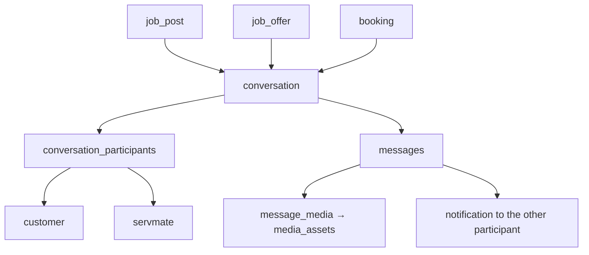
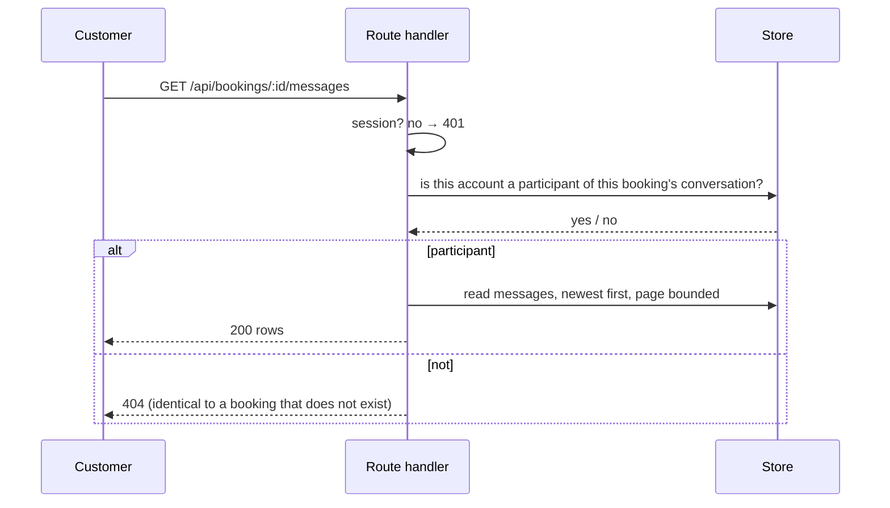
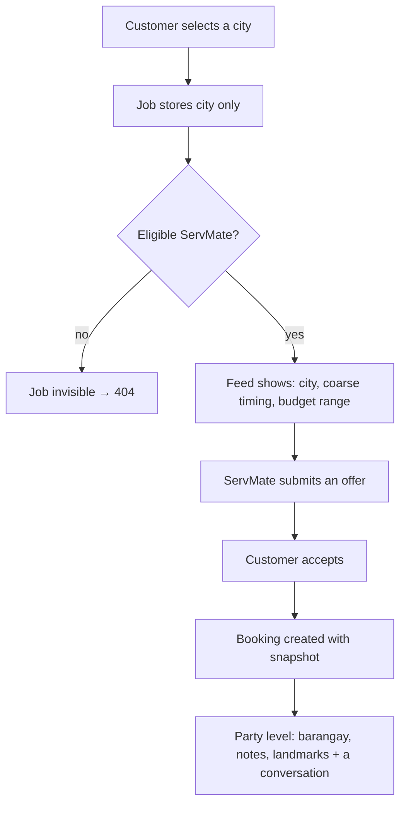

# Architecture — Messaging and Location

Two closely related concerns, for one reason: **a conversation is where the sensitive location
detail is finally safe to say, and only to one party.**

---

## Messaging

### The model

A conversation is a row. Membership is a row in `conversation_participants`, never an inference
from a booking. That single decision is what makes "non-participants cannot read this" a lookup
rather than a guess, and it survives the introduction of group conversations without a rewrite.

A conversation is created when there is a reason: an offer, an accepted offer, or a booking. There
is no "message anyone" path, which is what removes unsolicited contact as a category of abuse.

### Read and write authorization

The write path is the same check plus validation: a non-empty body within the length cap, and a
re-check that the conversation is not read-only (a block makes it read-only without deleting
anything).

Messages are ordered by creation time and paginated. There is no realtime transport at this
revision: the page polls. The seam is deliberate — messages are rows, and the notification write is
one function, so a websocket or server-sent channel can be added without changing who may read what.

### Attachments

An attachment is a `media_assets` row with `visibility = message_private`, referenced by
`message_media`. It is fetched through `/api/media/<id>`, which re-checks entitlement on every read,
so a leaked URL is worthless. Size and type limits match job media (≤ 3 MB, allowlisted type, byte
signature checked).

### What messaging deliberately is not

- Not a general social channel: no contact without a marketplace reason.
- Not a place for a record that outlives a dispute: message history outlives a closed job, but the
  *actions* that are no longer valid are refused. Retention and deletion are open decisions.
- Not logged. Message bodies never appear in application logs.

---

## Location

### The three types, kept distinct

Most location bugs come from conflating these. They have different owners, different lifetimes and
different audiences.

| Type | Example | Owner | Audience | Lifetime |
|---|---|---|---|---|
| **Service coverage** | "Pasig, Mandaluyong" | the ServMate | shown on their public profile | until changed |
| **Job area** | "Quezon City" | the customer | eligible ServMates only | the job's life |
| **Exact context** | "Barangay Poblacion, gate code 1234" | the customer | the assigned ServMate (or an offer holder) | the booking's life |

Coverage is a *matching input*. Job area is a *discovery input*. Exact context is an *execution
input* and is the only one that is sensitive enough to require a relationship to see.

### The flow

Barangay and notes travel from the customer's draft to the store, but they are **omitted from every
projection below `party`**. An eligible ServMate who has not offered learns the city and nothing
finer; that is what makes "the job post does not publish my home" true rather than aspirational.

### Why there is no map pin

A pin is either exact (publishing the home) or fuzzed (misleading about the work). A city label plus
a conversation is honest about both. Adding a pin would require deciding how much aggregation is
enough to be safe, and that decision belongs to a threat model, not to a UI component. It is
recorded as an open item in [docs/PROJECT_ROADMAP.md](docs/PROJECT_ROADMAP.md).

### Address changes after booking

The booking's agreed scope freezes the amount and the schedule, deliberately **not** the address. A
customer may correct their address mid-booking, and the assigned ServMate sees the corrected one; the
snapshot exists to protect the price, not to pin a family to a mistyped barangay.
