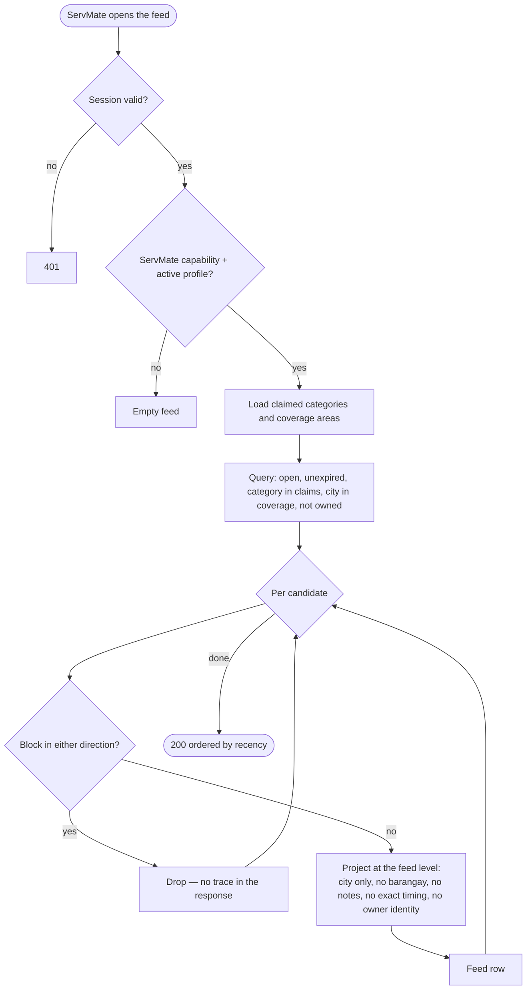

# Architecture — Privacy and Matching

This is the part of ServEm that is not a marketplace feature but a safety property. A job post
names a home. Matching decides how many strangers learn that, and what exactly they learn.

---

## The threat, stated precisely

A job post necessarily contains the things a worker needs: what, roughly where, roughly when,
roughly how much. It also attracts the things a customer must not have to publish: a unit number,
a gate code, a landmark, the exact hour nobody is home, a budget ceiling they would rather not
reveal. And it must not become a directory: a browsing stranger must not be able to enumerate
"every job in my barangay about a stolen phone".

Three concrete harms follow, and each maps to one rule.

| Harm | Rule |
|---|---|
| A job is visible to everyone, so a customer's home is public | **Eligibility is a predicate, not a filter.** Only categories × areas an eligible ServMate has claimed while active. |
| A coarse location leaks to an eligible-but-unrelated worker | **Coarse is the maximum.** City only; barangay and notes are visible only to a party who has a live offer or the booking. |
| A blocked account keeps watching, and learns it was blocked | **A block is symmetric in effect and private in fact.** |
| Probing distinguishes "not allowed" from "does not exist" | **Refusal is indistinguishable from absence.** |

## The matching flow



The two boxes that matter are **claims** and **project**. Nothing downstream of `claims` can add a
job the viewer did not claim, and nothing downstream of `project` can add a field the viewer is not
entitled to. A filter is applied to the output of this pipeline, which is why a wider filter can only
narrow the set further.

```mermaid
flowchart LR
  subgraph v["Viewer claims"]
    c1[category ids]
    c2[coverage areas]
    c3[providerStatus = active]
  end
  subgraph j["Job facts"]
    j1[category id]
    j2[location city]
    j3[status = open + unexpired]
    j4[owner]
  end
  c1 --> p{{eligibility predicate}}
  c2 --> p
  c3 --> p
  j1 --> p
  j2 --> p
  j3 --> p
  j4 --> p
  blocks[v["blocks — both directions"]] --> p
  p -->|true| ok[visible at feed level]
  p -->|false| no[404 — same as absent]
```

## The matching algorithm

It is deliberately plain, so that it can be read and audited rather than scored and trusted:

```
eligible(viewer, job) =
      job.status == open
   ∧  job.expiresAt > now
   ∧  job.customerId != viewer.userId
   ∧  viewer.providerStatus == active
   ∧  viewer.categoryIds ∋ job.categoryId
   ∧  job.locationCity ∈ viewer.serviceAreas
   ∧  ¬blocked(viewer, job.customerId)
   ∧  ¬blocked(job.customerId, viewer)
```

Every conjunct is necessary and none is a preference. There is no ranking, no paid placement, and
no "boosted" job — so there is no configuration under which an unrelated account is shown a job,
and no configuration that a customer can be sold that overrides their own privacy rule.

**Why no distance ranking:** distance needs a location, and ServEm has decided not to hold one.
Ranking by an inferred centroid would mean storing something the product has promised not to
store, and it would make "the closest worker" a function of data the customer never agreed to
share. Recency plus area is the honest order.

**Why budget is one-way:** the customer's number is shown to eligible ServMates because it is part
of deciding whether to answer. A ServMate's number is shown to the customer only on their offer.
Neither sees the other's history of numbers.

## Projection levels

Discovery is not one projection; it is three levels, applied by relationship. The names are in
`docs/security/access-control.md`; the fields are here.

| Level | Who | Fields |
|---|---|---|
| `feed` | any eligible ServMate | title, category, city, coarse timing, budget range, description, media, owner first name |
| `detail` | the same viewer once eligible | everything in `feed`, plus precise-enough scheduling and the offer affordances |
| `party` | the owner, an offer holder, the assigned ServMate | barangay, notes, landmarks, exact address context, the negotiation thread |

A viewer whose eligibility lapses — a block, a suspended profile, a category they just removed —
loses the level, and the answer becomes `404`. Not an empty feed row, not a redacted one: absent.

## Why the check comes before the projection

The ordering is the whole implementation of "indistinguishable". If a handler resolved a job by
id, filtered it, and then decided whether to answer, the two branches might differ in timing,
body, or logging. Instead the handler asks the eligibility function first; a `false` leaves the
handler with nothing to project and it returns the same `404` an unknown id returns.

Two consequences worth stating because they are easy to regress:

- **Eligibility functions are pure** (`lib/matching.ts`), taking the viewer, the job and the
  relationship facts. They are unit-tested directly, without HTTP, which is why the tests can
  assert "a wider filter never widens the set".
- **A block removal must restore nothing else.** Unblocking restores eligibility for future jobs;
  it does not resurrect an offer that was withdrawn while blocked. Deletion of history is a
  separate decision, and it is not automatic.

## What is deliberately not collected

No device location, no contact list, no background GPS. The city a customer selects is the only
place signal in the system, and it is theirs to choose. A "near me" feature would require
collecting more, so it is not built; the roadmap states the decision it would require first.

## Residual risks

1. A determined customer can put identifying detail in the free-text description. The write form
   warns and the moderation flow can act, but text is not automatically redacted.
2. Coarse filtering is per-city. A small city may contain few jobs, which weakly reduces
   anonymity for its few posters. Acceptable at launch scale; revisit before scaling a single
   dense city, where a "jobs in your city" feed would gain little.
3. The eligible set is exact, so a ServMate can infer that a customer selected their category and
   area — nothing about the customer, but a fact about the customer's request. That is inherent
   to a request-based marketplace.
