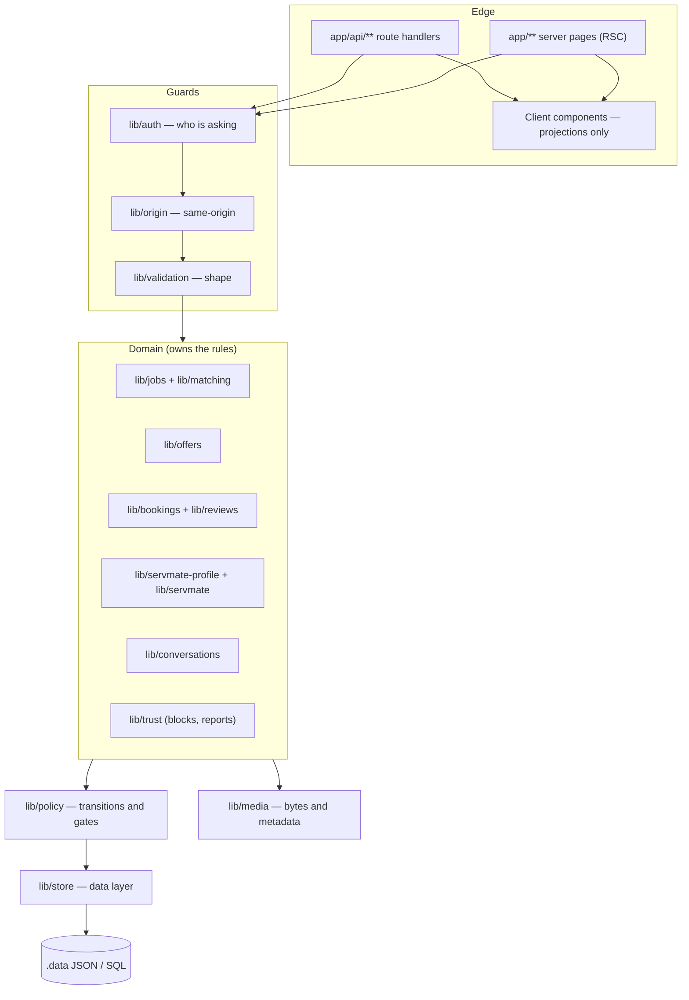

# Architecture — Components

ServEm is one deployable web application with a set of internal modules that are strict about
what they know. The boundary that matters is not "client and server" but **who is allowed to
learn what**, and that boundary is enforced inside the process, not at the network edge.

```
                    ┌──────────────────────────────────────────┐
  browser  ────────▶│  app/            route handlers (API)    │
                    │                  server pages (RSC)      │
                    └────────────┬─────────────────────────────┘
                                 │  session only, never a user id
                    ┌────────────▼─────────────────────────────┐
                    │  lib/auth.ts        who is asking        │
                    │  lib/origin.ts      same-origin check    │
                    │  lib/validation.ts  is the shape sane    │
                    └────────────┬─────────────────────────────┘
                                 │
        ┌────────────────────────┼──────────────────────────┐
        │                        │                          │
┌───────▼────────┐    ┌──────────▼─────────┐    ┌───────────▼─────────┐
│ lib/jobs.ts    │    │ lib/offers.ts      │    │ lib/bookings.ts      │
│ lib/matching   │    │ lib/servmate*.ts   │    │ lib/reviews.ts       │
│ (eligibility)  │    │ (provider console) │    │ lib/conversations.ts │
└───────┬────────┘    └──────────┬─────────┘    └───────────┬─────────┘
        └────────────────────────┼──────────────────────────┘
                                 │
                    ┌────────────▼─────────────────────────────┐
                    │  lib/policy.ts   transitions and gates    │
                    │  lib/store.ts    the data layer           │
                    │  lib/media.ts    bytes are not rows       │
                    └──────────────────────────────────────────┘
                                 │
                    ┌────────────▼─────────────────────────────┐
                    │  .data/  JSON document store (dev)        │
                    │  or the SQL schema of the same shape      │
                    └──────────────────────────────────────────┘
```

## Responsibilities

**Route handlers** (`app/api/**/route.ts`) are thin. Their whole job is: require a session, check
the origin on a mutation, parse and validate the body, call a domain module, and translate its
result into a status code. No handler contains a discovery rule, and no handler writes a field
that a domain module owns.

**Server pages** (`app/**/page.tsx`) call the same domain modules the API calls, with the session
account. A page cannot show a row the API would refuse, because both go through the same
eligibility functions. Client components receive only projections.

**Domain modules** are the only place a table is read or written. Each owns one noun and the
rules about it. `lib/matching.ts` holds eligibility as a pure function of the viewer, the job and
the relationships, so the feed, the detail page and the offer route cannot drift apart.

**`lib/policy.ts`** is the single registry of status transitions and gates: which booking
transitions are legal for which actor, when a job is editable, when an offer may be accepted. A
new transition is added here once, not at each call site.

**`lib/store.ts`** is the data layer: reads, writes, atomic transactions and migrations, with no
notion of who is asking. It returns everything it has and trusts nobody — which is exactly why
projections exist above it.

**`lib/media.ts`** treats bytes as a separate concern from metadata: an asset row, a fetch
authorized against the asset's owning entity, a type allowlist, and a byte-length check so a
declared `image/png` cannot smuggle something else.

## Why this shape

- **The leak we are actually designing against is a projection leak.** A field that exists on a
  row and is omitted on the way out is safe; a field assembled in a page is not. So projections
  live in the module that owns the noun, and a page that wants a new field must ask that module
  for it.
- **Refusals are indistinguishable from absence.** `notFound()` for both means a probe learns
  nothing. This only works if the check happens before any projection is built, so eligibility is
  resolved first and projection second.
- **Two sides of the same data.** The customer console and the ServMate console read the same
  rows and differ only in which projection they are entitled to. That is why the workbench has no
  private copy of a booking.

## Module graph

The arrows are *calls*, not imports: a domain module may call the store, and nothing above it calls
the store directly.



## Deliberate omissions at this revision

No queue, no scheduler, no websocket, no search index, no object store. Each has a designated
seam: expiry reads the clock (a cron job calls the same sweep), notifications are written through
one function (a worker can drain them), messages are rows (realtime can fan them out), discovery
is an indexed predicate (a search index can mirror it).
