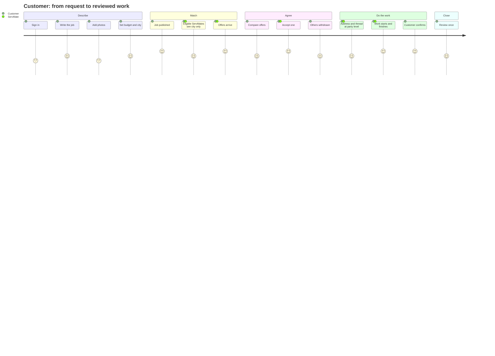
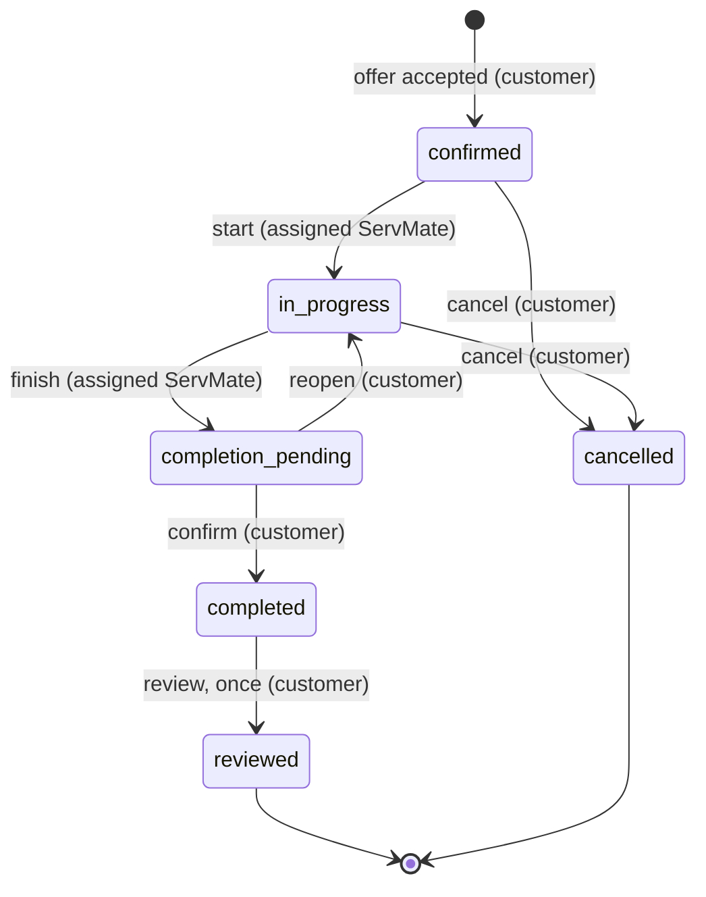
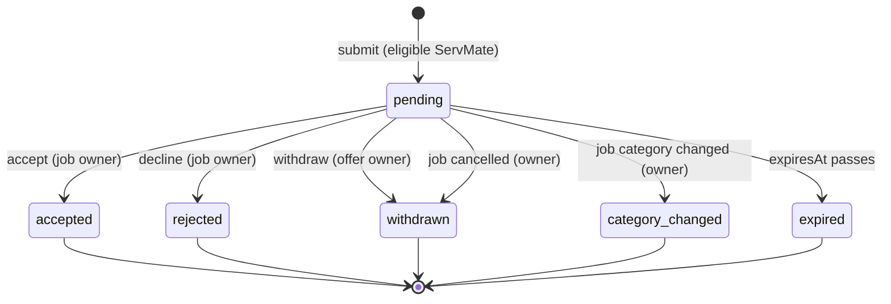
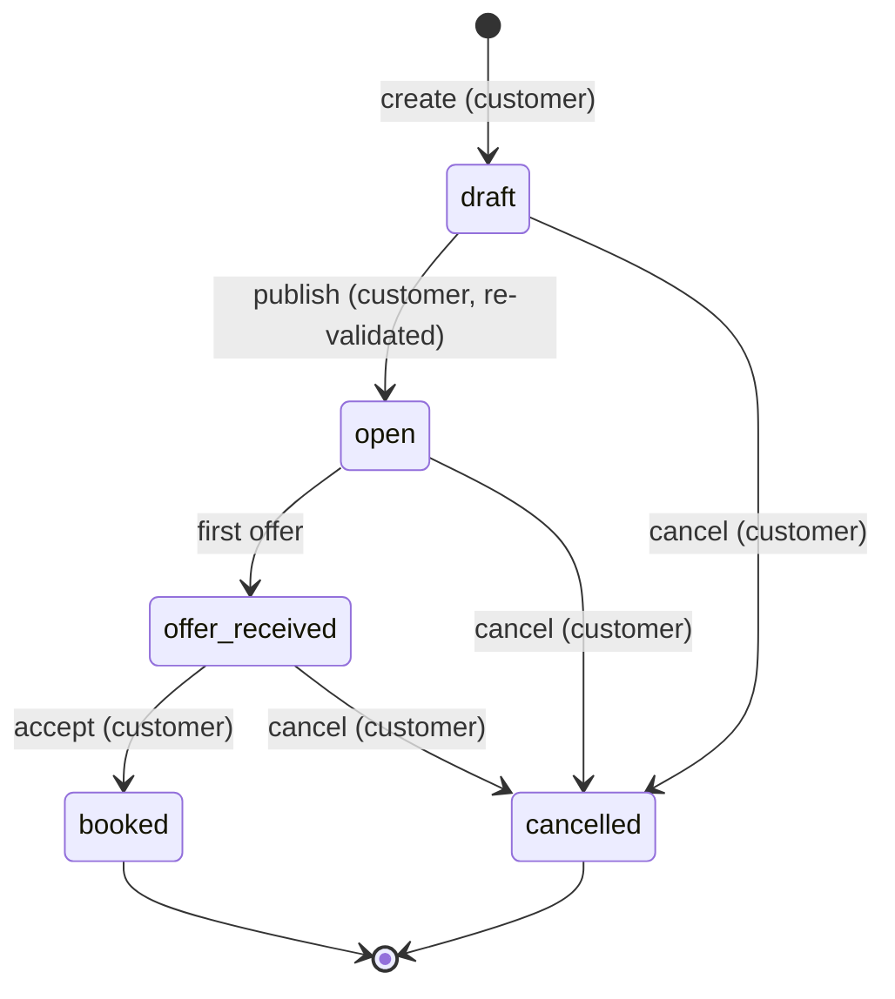

# Architecture — Data Flow

Every flow below is written as the sequence of authority checks that actually runs, because that
ordering is the design. The rule is always: **resolve the viewer, then resolve the entity and the
viewer's relationship to it, then check eligibility, and only then build the answer.**

---

## 1. Sign-up and session

```
browser ──POST /api/auth/signup──▶ handler
   same-origin?          no  ──▶ 403
   body valid?           no  ──▶ 400 field errors
   email already taken?  yes ──▶ 400 (generic, no account enumeration beyond the field)
   create user           store.createUser (scrypt hash, never the plaintext)
   create session        opaque token, expiresAt
   Set-Cookie            HttpOnly, SameSite=Lax, Secure in production
   ◀── 201 { account }
```

Everything downstream replaces "body valid" with "session present": `getSessionAccount()` reads
the cookie, resolves the token to a user, and returns `null` for an expired or unknown token. A
`null` account is a `401`. No handler ever reads a user id from the request.

## 2. Job creation and publication

```
draft:    POST /api/jobs          ▶ validate facts ▶ store.createJob (status draft)
media:    POST /api/jobs/:id/media ▶ owner? ▶ type+size+bytes ▶ asset row + join row
publish:  POST /api/jobs/:id/publish
            owner?                     no ▶ 404
            editable status?           no ▶ 409
            stored draft re-validates? no ▶ 400 (a category later removed from the registry)
            status = open, publishedAt, expiresAt
```

Publication re-validates the **stored** draft rather than trusting that creation validated it.
This matters because the registries are code, not data: a category can be retired between the two
calls, and the job must not become discoverable under a rule that no longer exists.

## 3. Discovery — the flow that decides privacy

```
GET /api/servmate/me/available-jobs      (details in docs/architecture/servmate-matching.md)
  session ▶ ServMate capability ▶ profile
  viewer facts: categories, areas, provider status, own blocks
  candidate rows: open, unexpired, not owned by the viewer
  per candidate: viewer category ∈ job category
                 job city ∈ viewer coverage
                 no block in either direction
  project AGAINST THE VIEWER  ── no barangay, no landmarks, no budget ceiling,
                                 no exact address, no owner identity
  ◀── 200 [ feed rows ]
```

The crucial consequence: **the sensitive projection is built per viewer inside the loop**, so a
wider filter can only return fewer of the rows the viewer is already entitled to. There is no code
path where a filter is applied to the unfiltered table.

## 4. Offer submission and acceptance

```
submit:   POST /api/servmate/me/available-jobs/:jobId/offers
            eligible? (exactly flow 3 for one job)   no ▶ 404
            own job?                                  yes ▶ 404
            live offer already?                       yes ▶ 409
            store.createOffer  (amountCentavos integer, scope, exclusions, expiry)
            notify the owner through lib/notifications.ts (skipped if the owner blocked them)

accept:   POST /api/jobs/:id/offers/:offerId/accept        ← one transaction
            owner of the job?             no  ▶ 404
            offer pending?                no  ▶ 409
            provider still eligible?      no  ▶ 409 (they were blocked or suspended)
            ─────────────────────────────────────────────
            booking row with the frozen snapshot (amount, scope, start)
            other live offers = withdrawn
            job = booked
            history row + notifications
          ◀── 201 { booking }
```

Acceptance is the only place where a number becomes an obligation, so it is the one place the
amount is copied rather than referenced. Editing the listing or the job budget afterwards cannot
reach it; only a new booking can.

## 5. Work to completion and review

```
confirmed ── start ──▶ in_progress ── finish ──▶ completion_pending ── customer confirms ──▶ completed
   │                             │                        │                                    │
   └─ customer cancels ─▶ cancelled (with reason)          └─ customer cancels ─▶ cancelled     └─ review (once)
```

Each arrow is a `lib/policy.ts` transition with an actor. The ServMate can start and finish; only
the customer can confirm, so a provider cannot unilaterally mark paid work done. The review is
then permitted exactly once thanks to the unique (booking, reviewer) constraint — the API check is
a courtesy, the constraint is the guarantee.

## 6. Blocking and reporting

```
POST /api/blocks        body: { userId }  ▶ not self ▶ target exists ▶ upsert row
                                                  ▶ discovery loses the job in both directions
                                                  ▶ open conversations become read-only

POST /api/reports       body: { target type, id, reasonCode, description }
                          entitled to see the target?  no ▶ 404
                          duplicate open report?       yes ▶ 409
                          insert moderation record (status open)
                          ◀── 201 { report }        visibility of the target: unchanged
```

A block is symmetric in effect and private in fact: neither account can learn the other blocked
them, and the report is a record that a moderator acts on rather than an automatic sanction.

## 7. Media read

```
GET /api/media/:id
   session required ▶ asset visible? (its owning job's rule, its owner's profile, or its message)
   asset deleted?   ▶ 404
   ◀── 200 bytes with the declared Content-Type, Cache-Control: private
```

Storage keys never appear in a response, so the only way to reach bytes is through the endpoint
that re-checks entitlement on every read.

---

## Diagrams

### The customer journey, and where privacy is enforced



### Booking state transitions

Every arrow names its actor. The dashed arrow is the one a provider cannot take.



### Offer lifecycle



The `category_changed` terminal state is the subtle one: when an owner recategorises a job, an offer
from a provider who is no longer eligible must not be silently deleted, because the provider is owed
the knowledge that their bid is void and why.

### Job lifecycle


