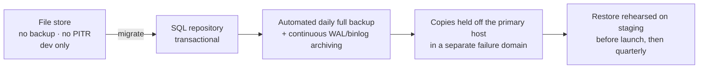

# Operations — Backup and Recovery

What the system can lose, what it cannot, and how long recovery is allowed to take. Written for the
current revision honestly: **the file-backed store has a weak recovery story, and the document says
so rather than describing a backup regime that does not exist yet.**

---

## What must not be lost

| Data | Loss consequence | Criticality |
|---|---|---|
| Bookings and their snapshots | agreed work disappears, both parties lose their record of price and scope | **critical** |
| Job posts (open) | missed work; recoverable by re-posting, at a cost to users | high |
| Offers (pending) | a ServMate's bid vanishes silently | high |
| Users and sessions | users cannot sign in; identity is unrecoverable | **critical** |
| Messages | disputes lose their evidence | high |
| Reviews | provider reputation and trust signal | high |
| Media bytes | the record of the work; metadata without bytes is a broken row | high |
| Reports and blocks | safety controls silently lapse | **critical** |
| Reference data (categories, areas) | re-seedable from code | low |

Media bytes and metadata are backed up as a pair. A restore that brings back rows pointing at
missing bytes is worse than no restore, because it looks healthy.

## Current reality (be explicit)

- The development store is a single JSON file under `.data/`. It is copied on write via a temp file
  and a rename, so a crash mid-write cannot truncate it — a torn file is not the failure mode.
- It is **single-process, single-instance, and has no automated backup**. It is a development
  stand-in; production must not use it.
- There is no point-in-time recovery, no replica, and no tested restore procedure, because there is
  nothing yet to restore from.

Do not describe the current setup as backed up. It is not.

## The plan, tied to the migration

Recovery quality is a consequence of the store choice, so it is scheduled with it
([docs/architecture/database-design.md](docs/architecture/database-design.md)):



### Targets

| Objective | Target | Why |
|---|---|---|
| **RPO** (acceptable data loss) | ≤ 5 minutes | a booking accepted seconds ago is a promise to two people |
| **RTO** (time to restore service) | ≤ 1 hour | an afternoon of downtime for a local marketplace is survivable; a lost booking is not |
| Media bytes | replicate at write | bytes and rows must be restorable together |

### Regime once on SQL

1. **Automated full backup daily**, retained 30 days, encrypted at rest.
2. **Continuous log archiving** to meet the 5-minute RPO.
3. **Off-host copies** in a failure domain that does not share the primary's — a backup beside the
   thing it protects is not a backup.
4. **Media bucket versioning** with a retention rule; deleted assets' bytes are erased only after
   the metadata deletion is durable.
5. **Restore rehearsal** on staging before launch and quarterly thereafter, timed and recorded.

## Restore procedure (once the SQL repository is in place)

```
1. Declare: stop writes to the primary (remove it from the pool).
2. Provision a fresh instance — restore into a new instance, never over the damaged one.
3. Restore the latest full backup, then replay archived logs to the chosen point in time.
4. Verify before serving:
     - row counts per table against the pre-incident expectation
     - every booking has one accepted offer and one snapshot
     - every media row resolves to bytes that exist
     - the most recent booking reference from the incident ticket is present
5. Point the application at the restored instance; confirm a readiness probe passes.
6. Re-enable writes; reconcile anything the incident ticket says happened after the restore point.
7. Do not delete the damaged instance until the incident is closed.
```

Step 4 is the one people skip, and it is the one that turns "we restored" into "we restored
correctly".

## Verification after any restore

| Check | Expected |
|---|---|
| A known booking opens for both parties | snapshot amount equals the agreed one |
| The job feed for an eligible ServMate | matches the pre-incident feed for the same account |
| A foreign account fetching a job by id | `404`, not a redacted row |
| Sign-in with a known account | succeeds; sessions created before the incident may be invalid, and that is acceptable |
| Media for a restored booking | bytes are served |

## Drills

| Drill | Frequency | Pass condition |
|---|---|---|
| Full restore to staging | before launch, then quarterly | RTO met, step-4 checks pass |
| Point-in-time restore to a chosen minute | after the SQL migration, then twice a year | the target row set is exactly as expected |
| Media-bytes-and-rows restore | before launch, then quarterly | no row without bytes |
| Session-invalidating incident | at the first real incident | the 401 wave is expected, not escalated as an outage |

## What recovery cannot fix

- **A leak.** Restoring does not un-disclose a field. Disclosure incidents go to the owner
  immediately ([docs/operations/operations-runbook.md](docs/operations/operations-runbook.md)).
- **A migration error.** Restoring brings back the data, not the correct schema; the migration that
  broke it must also be corrected before re-running.
- **A lost key.** Backups are encrypted; the key's own escrow is a launch checklist item, and losing
  it loses everything. That is a launch gate, not an operational precaution.
