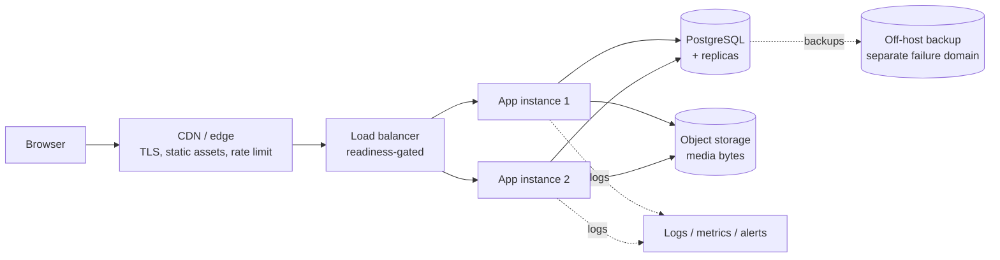

# Operations — Deployment

How ServEm goes from a checkout to a running environment, what each environment is for, and what
has to be true before a launch.

---

## Environments

| Environment | Purpose | Data | Notes |
|---|---|---|---|
| Local | development and the e2e script | seed + local writes in `.data/` | `npm run dev`, no external services required |
| Staging | pre-launch verification | its own database, disposable | the place the launch gate list is actually walked |
| Production | real customers | its own database, backed up | the only environment with real money |

Configuration is by environment variable, documented in [.env.example](apps/public-web/.env.example).
A value that is absent disables the feature that needs it rather than failing at request time — the
social sign-in buttons are hidden when no provider is configured, so a half-configured environment
is visibly half-configured instead of broken on click.

## Build and run

```bash
cd apps/public-web
npm ci                 # exact lockfile install
npm run build          # next build: types, routes, static output
npm start              # next start (production server)
```

Node `>= 20.9.0` is declared in `package.json` `engines`; the build is not supported below it. The
server is stateless apart from the data store, so it can be restarted at any time and can run more
than one instance behind a load balancer **once the store is the SQL repository** — with the
file-backed store it must be a single instance.

## Configuration checklist

| Variable | Required | Effect when absent |
|---|---|---|
| `SESSION_SECRET` / session signing | production yes | sign-in works locally only; do not launch |
| `DATABASE_URL` (post-migration) | production yes | falls back to the file store |
| `GOOGLE_CLIENT_ID` / `SECRET` | no | Google sign-in hidden |
| `APPLE_CLIENT_ID` / `SECRET` | no | Apple sign-in hidden |
| `APP_ORIGIN` | production yes | used for OAuth redirect URIs and same-origin checks |

OAuth redirect URIs must be registered per environment and match `APP_ORIGIN` exactly; a mismatch
is the most common source of a callback `400`.

## First-deploy order

1. Provision the database and apply migrations, then seed only the reference data (categories,
   coverage areas) — never demo accounts.
2. Deploy the application with provider config absent; confirm the storefront renders and sign-up
   works.
3. Add the OAuth credentials; confirm sign-in, callback and sign-out on the deployed origin, not
   only locally.
4. Confirm the signed-out `401`s and a foreign-origin `403` on the deployed origin.
5. Walk the launch gates in `docs/PHILIPPINES_LAUNCH_GATES.md` on staging, then repeat on
   production.

## Health and readiness

- A readiness probe should require an HTTP 200 from a cheap page **and** a successful store read,
  so a process that is up but cannot reach data is not sent traffic.
- A liveness probe should be the process itself, without the store check, so a data outage does not
  cause a restart loop.
- The application logs one line per request at the edge and structured errors in handlers. Nothing
  sensitive is logged — see `docs/security/access-control.md`.

## Media storage

Uploads are of two kinds: local development keeps bytes on disk with metadata in the store, and a
real deployment puts bytes in object storage with the store holding only the key and the metadata.
`docs/architecture/database-design.md` records why the key is never in a response. A deployment
that has not configured object storage should treat the media feature as not launched, rather than
serving from the application's own filesystem.

## Rollback

The application is stateless, so a rollback is a redeploy of the previous build. The database is
the constraint: a migration that drops or renames is not backward compatible, so migrations are
additive for one release before a destructive cleanup, which makes "roll back the code, keep the
data" always possible. The file store's only rollback is restoring the file, which is why production
must not use it.

## What is deliberately not here yet

## Target topology

The current revision runs as one process. The shape below is what the configuration supports once
the store is the SQL repository and a second instance is safe.



Today, `app2` must not be enabled and `db` is the file store. Everything else in the diagram is the
intended production shape, and [docs/operations/backup-and-recovery.md](docs/operations/backup-and-recovery.md)
says which parts of it do not exist yet.

## What is deliberately not here yet

No container image, no orchestrator manifests and no CI pipeline are committed at this revision.
That is a deliberate deferral, not an oversight; the deliverables and their intended shape are
recorded in `docs/PROJECT_ROADMAP.md`. The build and run commands above are the contract those
deliverables would wrap — a container would `npm ci && npm run build` and run `npm start`, and a CI
pipeline would run `npm test` and `npm run build` on every change.
