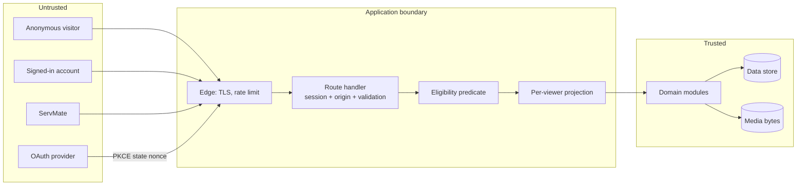

# Security — Threat Model

What we defend against, what we accept, and what would have to change for an accepted risk to
become unacceptable. The controls themselves are in
[docs/security/access-control.md](docs/security/access-control.md); this document is the reasoning
that chose them.

---

## The system in one line

A marketplace where posting a request tells a stranger where you live, so **the product's central
security property is not authentication — it is the size and composition of the audience for a
private job post.**

## Trust boundaries

Nothing crossing from `untrusted` to `handler` is believed: the session is resolved from the cookie,
the origin is checked, and the body is validated before a domain module sees it. The projection is
built *after* eligibility, inside the module that owns the data — the single ordering rule this
model depends on.

## Threats

| # | Threat | Likelihood | Impact | Control | Residual |
|---|---|---|---|---|---|
| T1 | Stranger enumerates job posts and learns where people live | high if unguarded | severe | eligibility = category × area, active profile, no block; refusal is `404` | a ServMate who matches still sees the job — that is the product |
| T2 | Eligible-but-unrelated worker reads the exact address | medium | severe | projection levels: barangay and notes only at `party` | free text can carry identifying detail |
| T3 | Unrelated account fetches a job by guessing its id | low | severe | resolve-then-check, `404` for absent and forbidden alike | none known |
| T4 | Non-participant reads messages or downloads attachments | low | high | participant rows checked per request; media entitlement follows the owning entity | none known |
| T5 | A blocked account keeps watching, and learns it was blocked | medium | high | block is symmetric in effect, private in fact, idempotent | the blocker's own list is visible to them, by design |
| T6 | Credential stuffing / password reuse | high | high | scrypt, generic failure, revocable sessions; fixed-window limits on sign-in and recovery per address+email and per address | in-process counter; shared counter before multi-instance |
| T7 | Session theft via XSS or a stolen cookie | medium | high | `HttpOnly` + `SameSite` cookie, no token in JS, current-password required to change it | theft before revocation is unrecoverable |
| T8 | CSRF on a state-changing request | medium | high | same-origin check on every mutation | none known |
| T9 | Concurrent offer acceptance creates two bookings | low | severe | one transaction + partial unique index on live offers | file store relies on its single writer |
| T10 | A later price edit changes agreed terms | medium | high | booking holds an immutable snapshot | none known |
| T11 | Malicious upload (HTML/SVG/script masquerading as an image) | medium | medium | type allowlist, size cap, byte-signature check, served `private` | no virus scanning |
| T12 | A provider self-declares verified status | medium | medium | `verificationStatus` is not writable from any provider route | operator tooling must set it |
| T13 | Report metadata leaks to the reported account | low | high | moderation records are readable only by their reporter (`/account/reports`) and by the operator console; the account a report names never sees it | the console's audit rows name an operator label, not a person |
| T14 | PII in logs | medium | high | log projections, never rows; no bodies, addresses or tokens | developer discipline, reviewed in PRs |
| T15 | Free-text description discloses an address | high | medium | write-form warning, moderation can act | no automatic redaction |

## Abuse cases with no attacker

The most common "threat" is a well-meaning user doing the harmful thing:

- **A customer pastes their full address into the description** because it is easy. T15.
- **A provider over-claims a portfolio item** as their own completed work. Neutralised by verifying
  the claim against a booking that is theirs and completed, server-side.
- **A customer posts a duplicate job** when they do not see offers. Mostly a visibility problem,
  addressed by notifications rather than by blocking.

## Assumptions

1. TLS terminates correctly; the deployment is not downgraded to plain HTTP.
2. The store is not reachable directly from the network.
3. Provider identity assertions are trustworthy at the level PKCE and `nonce` require.
4. The operator who unlocks the moderation console is trustworthy; there is no in-product defence
   against a hostile operator, and that is a hiring control, not a code control. What the code does
   is bound the exposure: the console needs the deployment's own credential rather than an account,
   it reads the case and the evidence a decision needs, and every action it takes is recorded in
   `moderationActions` under the operator label.

## What would change this model

- **A "near me" feature** would require collecting location, which is the single largest addition to
  the asset list. It needs its own threat model before it is built.
- **An operator API** was built as the moderation console (`lib/moderation.ts`,
  `lib/moderation-access.ts`, `/moderation`), and it introduced the trust boundary this document
  predicted — a new class of insider risk, handled by not reusing the customer session model: the
  credential is a server secret, the browser holds only its digest, an account cannot promote
  itself in, and every refusal is the same `404`. What remains unmodelled is **two-person review** —
  one operator can decide a case alone — and that is a process control, not a code one.
- **Payments** add settlement, refunds and dispute state, and with them a financial-integrity
  boundary where a partial transaction has a monetary cost.
- **Scaling past one instance** changes the atomicity argument from "one writer" to "database
  transactions and row locks"; the concurrency tests named in the testing strategy become required,
  not optional.
