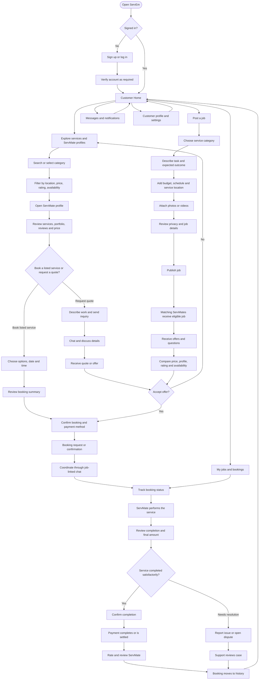
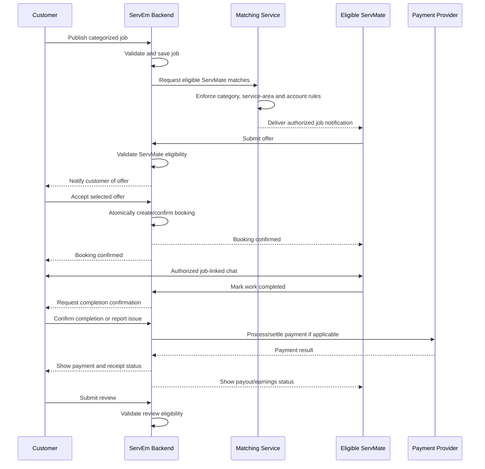

# ServEm Customer User Flow

**Document purpose:** Define the end-to-end customer experience for ServEm, a service marketplace that connects customers with relevant ServMates.

**Product rule:** ServEm has one shared marketplace. Customers can discover public ServMate profiles and services, or privately post a job to receive offers from eligible ServMates. A ServMate has a profile and service offerings—not a separate “ServMate Shop.”

---

## 1. Customer journey at a glance



---

## 2. Step-by-step customer flow

### Step 1 — Open ServEm and authenticate

1. Customer opens ServEm.
2. If signed out, they can register, log in, or use supported account recovery.
3. Complete required email/phone verification and accept the applicable terms and privacy notice.
4. Select or enter the customer profile details required to use the marketplace.
5. Route the user to the customer home screen after successful authentication.

**Expected result:** The customer has an authenticated account and can browse public marketplace content.

**Important:** Authentication does not grant access to private job posts, private media, or conversations unless the backend authorizes that specific access.

### Step 2 — Customer home

The home screen should provide clear entry points for:

- Search and service categories.
- Public ServMate profiles and service offerings.
- A primary **Post a Job** action.
- Current offers, bookings, and job status.
- Messages and notifications.
- Saved ServMates or favorites, if implemented.
- Customer profile, addresses, preferences, help, and settings.

The home feed may show public service content. It must not expose private customer job posts to unrelated customers or unauthorized users.

### Step 3A — Discover a ServMate

1. Customer searches for a service or chooses a category.
2. Customer applies supported filters, such as location/service area, price, rating, and availability.
3. ServEm returns eligible public ServMate profiles or service listings.
4. Customer opens a ServMate profile.
5. Customer reviews the ServMate’s bio, relevant service categories, price/rate, availability, service area, portfolio/work examples, reviews, and verification indicators.
6. Customer chooses to book a defined service or send an inquiry/request for a quote.

**ServMate profile contents:** profile information, offered services, skills, pricing, availability, work history/portfolio, public posts, and reviews. Do not create a separate ServMate Shop.

### Step 3B — Post a job

The customer uses a guided form, preferably with a draft that can be saved before publication.

Required or conditionally required fields:

- Service category and optional subcategory.
- Job title and clear description of the work.
- Expected result, constraints, and relevant details.
- Budget or price range; allow the customer to edit it before publishing.
- Preferred date/time or a flexible schedule.
- Service location and relevant access instructions.
- Photos/videos showing the work area or problem.
- Optional additional notes.

Flow:

1. Select the correct service category.
2. Describe the job and expected outcome.
3. Enter budget, schedule, and service location.
4. Add photos/videos if useful.
5. Preview the post and check for sensitive information in uploaded media.
6. Confirm the post is accurate and publish.
7. Show a clear success state and link to the job details page.
8. Allow the customer to edit, pause, cancel, or close the post according to its state and whether offers/bookings already exist.

**Private matching rule:** A job is visible only to ServMates authorized for its category and applicable matching criteria, such as service area and account status. Customers do not get to browse other customers’ private jobs. The backend must enforce this rule for feeds, search, API requests, notifications, realtime events, media, exports, and direct URLs.

### Step 4 — Receive and compare offers

1. Matching ServMates can review the eligible job and submit offers.
2. Customer receives a notification when a valid offer arrives.
3. Customer opens the job’s offer list.
4. Each offer should show relevant information such as:
   - ServMate profile and verification status.
   - Rating and review count, where available.
   - Proposed price and what it includes.
   - Proposed date/time or arrival window.
   - Relevant portfolio examples.
   - Message, exclusions, and conditions.
5. Customer can ask questions, request clarification, decline an offer, or accept one.
6. The customer must see a confirmation summary before committing.

Do not imply that an offer is a confirmed booking. An offer becomes a booking only after the required acceptance and confirmation checks succeed.

### Step 5 — Confirm a booking

Before confirmation, show:

- Selected ServMate and service.
- Job description and agreed scope.
- Agreed price, fees, taxes, and total where applicable.
- Schedule and service location.
- Cancellation/rescheduling rules.
- Payment method and payment timing.
- Any deposit, authorization, or refund conditions that actually apply.

On confirmation:

1. Backend validates that the job/offer is still eligible and not already awarded or cancelled.
2. Backend checks the customer and ServMate are allowed to proceed.
3. Backend creates or updates the booking transactionally to prevent duplicate acceptance.
4. Booking state and payment state are recorded separately.
5. Both parties receive a confirmation and the booking appears in their respective job lists.

Payment methods and escrow/hold behavior depend on the payment provider and the implemented business rules. Never display a payment as successful until the provider/backend confirms it.

### Step 6 — Chat and coordinate

- Provide a conversation tied to the relevant job or booking.
- Allow both parties to clarify scope, schedule, materials, and arrival instructions.
- Support read/unread state and notifications where implemented.
- Keep messages accessible only to authorized conversation participants and permitted support staff.
- Protect images, videos, attachments, and location data using authorization checks.
- Avoid exposing personal contact details or exact location unnecessarily before they are needed.

### Step 7 — Track the job

The customer’s job/booking detail screen should display a clear status timeline. A possible lifecycle is:

`draft → published → offers_received → offer_accepted → confirmed → in_progress → completion_pending → completed`

Cancellation, expiration, payment failure, and dispute states should be handled explicitly. The exact states must align with the existing repository’s domain model after the coding agent audits it.

Customer actions depend on state, for example:

- Edit or withdraw a published job before an offer is accepted.
- Compare and respond to offers.
- Confirm an accepted offer.
- Message the assigned ServMate.
- Request rescheduling or cancellation under policy.
- Confirm completion or report an issue.
- View receipts and history.

### Step 8 — Completion and issue resolution

1. ServMate marks the service as completed.
2. Customer receives a completion notification.
3. Customer reviews the agreed work and final amount.
4. If satisfied, customer confirms completion.
5. If there is a problem, customer can report it and submit relevant evidence.
6. A dispute or support workflow records the case and prevents inappropriate automatic finalization while it is being reviewed.

A completion action must not silently change payment state or bypass a dispute hold.

### Step 9 — Payment and receipt

- Display the payment status separately from the service status.
- Show the agreed price, authorized adjustments, fees, payment method, transaction reference, and receipt where available.
- Handle payment pending, succeeded, failed, refunded, and disputed states as appropriate.
- Make retries idempotent so refreshing or repeating an action does not charge twice.
- If the marketplace supports cash, clearly record that status without falsely claiming an online payment was processed.

### Step 10 — Review and return

1. After an eligible completed booking, invite the customer to review the ServMate.
2. Allow a rating and written feedback; optional structured feedback may be added.
3. Enforce one eligible review per booking, with a defined edit/moderation policy.
4. Display the review publicly only according to the platform’s review and privacy policy.
5. Move the booking into history and offer actions such as viewing the receipt, contacting support, or hiring the same ServMate again.

---

## 3. Customer navigation map

```text
Customer App
├── Home
│   ├── Search
│   ├── Service Categories
│   ├── Public ServMate Profiles
│   └── Post a Job
├── Discover
│   ├── Search Results
│   ├── Filters
│   ├── ServMate Profile
│   ├── Services and Pricing
│   ├── Portfolio and Reviews
│   └── Request Quote / Book
├── My Jobs
│   ├── Drafts
│   ├── Published Jobs
│   ├── Offers
│   ├── Confirmed Bookings
│   ├── In-progress Jobs
│   ├── Completion / Disputes
│   └── Job History and Receipts
├── Messages
│   └── Job- or Booking-linked Conversations
├── Notifications
├── Saved ServMates (optional)
├── Customer Profile
│   ├── Personal Details
│   ├── Saved Addresses
│   ├── Privacy and Security
│   └── Account Settings
└── Help and Support
```

---

## 4. Customer and ServMate handoff



---

## 5. Essential customer-side screens

1. Sign up, login, verification, and account recovery.
2. Customer home and service category discovery.
3. Search results and filters.
4. ServMate profile and service details.
5. Job creation wizard, media upload, preview, and edit.
6. Customer job detail and offer comparison.
7. Offer details and acceptance confirmation.
8. Booking summary and payment selection.
9. Booking/job status timeline.
10. Job-linked messaging.
11. Completion confirmation and dispute reporting.
12. Payment status, transaction history, and receipt.
13. Review submission.
14. Notifications.
15. Customer profile, saved addresses, privacy settings, and support.

---

## 6. Core acceptance criteria

- A customer can register, browse public services, and open public ServMate profiles.
- A customer can create, preview, publish, edit, and withdraw a job within permitted states.
- A job’s category is required and validated by the backend.
- Only eligible ServMates can retrieve a private job or its media.
- An unauthorized customer or unrelated ServMate cannot retrieve private job data by guessing IDs or calling endpoints directly.
- Offers are linked to the correct job and ServMate, and the customer can compare offers before accepting one.
- Concurrent offer acceptance cannot assign the same job to multiple ServMates.
- Booking status and payment status are separate and accurate.
- Both parties can communicate only when authorized.
- Cancellation, rescheduling, payment failure, completion, and disputes have explicit outcomes.
- Only eligible completed bookings can be reviewed.
- Every critical action is validated on the backend and covered by automated tests.

---

## 7. Instructions for the coding AI

Implement this flow inside the existing **ServEm** repository. First inspect the current architecture, routes, components, database schema, authentication, and tests. Preserve working features and identify where the current implementation differs from this specification. Adapt the flow to the existing stack instead of creating an unrelated application or blindly replacing the repository.

Implement incrementally. For each phase, update the UI, APIs, database migrations, permissions, validation, error handling, tests, and documentation as appropriate. Prioritize server-side authorization and category-based job privacy. Run the relevant tests and report what was actually verified; do not claim a feature is complete merely because a screen or mockup exists.
