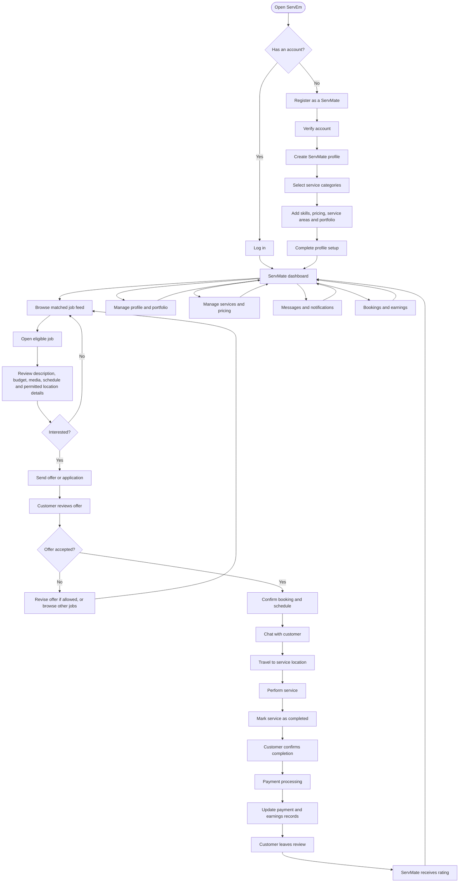

# ServEm — ServMate User Flow

## Purpose

This document defines the ServMate journey in ServEm, from registration through job discovery, offers, bookings, service completion, payment, and reviews. It is intended for the AI coding agent implementing the existing ServEm application.

## 1. End-to-end flow diagram



## 2. Detailed user journey

### Stage 1 — Registration and verification

1. ServMate opens ServEm and chooses to register or log in.
2. New users provide the required account details and verify their account using the configured verification method.
3. The system establishes the account identity and role permissions.
4. Existing users authenticate and are routed to the correct dashboard.

**Requirements**
- Validate all input on both client and server.
- Apply rate limits to authentication and verification endpoints.
- Never store passwords in plaintext.
- Do not grant privileged capabilities based solely on a client-submitted role value.

### Stage 2 — Create the ServMate profile

The ServMate creates and maintains one profile containing:
- Display name and profile photo.
- Bio, skills, qualifications, and experience.
- Service categories and specific services offered.
- Pricing approach (fixed, starting price, hourly, or quote-based, as supported).
- Service area and availability.
- Portfolio photos/videos and work history.
- Reviews and rating summary, generated from eligible completed bookings.

There is **no separate “ServMate Shop.”** Services and portfolio content belong to the ServMate profile.

**Profile states:** `draft → pending_review` (if review is required) `→ active`; also support `rejected`, `suspended`, or `deactivated` where appropriate. Define and enforce the actual state transitions in the backend.

### Stage 3 — ServMate dashboard

The dashboard should provide clear access to:
- Matched job feed.
- Profile and portfolio management.
- Service categories, offerings, and pricing.
- Offers/applications and their statuses.
- Upcoming and active bookings.
- Messages and notifications.
- Earnings and payment history.
- Reviews, account settings, help, reports, and dispute handling.

Show useful empty, loading, error, and offline states. Do not display fake production data as though it were real.

### Stage 4 — Discover eligible jobs

The job feed should show jobs that the ServMate is authorized to access. Eligibility should consider:
1. The ServMate's active service categories and the job's requested category.
2. The job's publication and current status.
3. The job's service area or location rules, if applicable.
4. Any additional eligibility or account restrictions defined by the product.

**Critical privacy rule:** A cleaning job must not be visible to a ServMate who is authorized only for plumbing. Enforce this in backend authorization and query logic—not just by filtering cards in the frontend. Apply the same authorization to job details, search, pagination, APIs, notifications, realtime events, media downloads, and direct URLs. Use deny-by-default behavior and test for cross-category data leakage.

Show only the location precision and customer information necessary at the current stage. Do not expose a customer's exact address publicly or to unrelated ServMates.

### Stage 5 — Review a job

A job detail screen may show, subject to authorization:
- Job title and description.
- Requested category and service details.
- Customer-provided budget or price range.
- Preferred schedule and availability.
- Relevant photos/videos.
- Approximate location or service area before booking, according to privacy rules.
- Job status and offer deadline, if applicable.
- An action to submit an offer or decline/return to the feed.

The server must authorize access every time a job or media asset is requested.

### Stage 6 — Submit an offer or application

The ServMate submits the information the product supports, such as:
- Proposed price and pricing basis.
- Message or scope clarification.
- Availability and proposed schedule.
- Optional relevant portfolio items.

The backend validates that:
- The job is open and accepts offers.
- The ServMate is eligible for the requested category and job.
- The offer amount and fields meet business rules.
- Duplicate or conflicting offers are handled idempotently.
- The request does not change another user's data.

Track offer states with explicit allowed transitions, for example: `submitted`, `viewed`, `accepted`, `declined`, `withdrawn`, `expired`, or `superseded`. Use only states that match the implemented product rules. Notify users through authorized channels.

### Stage 7 — Acceptance and booking confirmation

When the customer accepts an offer:
1. Validate the job and offer are still eligible for acceptance.
2. Prevent competing offers from creating conflicting confirmed bookings.
3. Create or update the booking transactionally.
4. Record the agreed scope, price, schedule, and relevant terms.
5. Notify both parties.
6. Reveal additional location details only to the confirmed parties when necessary.

An accepted offer and a confirmed booking may be distinct states. Specify the exact transition and enforce it on the server. Do not rely on a frontend button to guarantee consistency.

### Stage 8 — Messaging and coordination

The ServMate can message the customer through an authorized conversation linked to the job or booking.

Requirements:
- Only conversation participants and explicitly authorized support roles may access messages.
- Enforce access to message history, attachments, typing/presence events, and realtime subscriptions.
- Validate and rate-limit message creation.
- Restrict attachment access to authorized participants.
- Provide report/block tools and a safe path for handling abusive behavior.
- Avoid exposing private contact details or precise location unnecessarily.

### Stage 9 — Perform the service

Before the appointment, the ServMate can review the confirmed scope, schedule, and permitted location details. During the job, the application should support the product's chosen status transitions, such as:

`confirmed → in_progress → completion_pending`

The precise workflow may differ based on whether customer confirmation is required. Store timestamps and actor IDs for important transitions. Handle cancellations, no-shows, rescheduling, and disputes through explicit backend rules rather than arbitrary status edits.

### Stage 10 — Completion and payment

1. ServMate marks the work complete.
2. If required, the customer confirms completion or raises a dispute.
3. The payment subsystem processes the applicable payment or records the chosen offline-payment process.
4. Payment status is updated only after verified payment-provider confirmation or a properly authorized manual process.
5. Earnings and transaction records are reconciled.
6. Both parties can see the correct status and relevant history.

Keep booking state and payment state separate. Example booking states: `confirmed`, `in_progress`, `completion_pending`, `completed`, `cancelled`, `disputed`. Example payment states: `unpaid`, `pending`, `paid`, `failed`, `refunded`, `partially_refunded`. Adapt these to the payment model actually implemented. Use idempotency and auditable transaction records.

### Stage 11 — Reviews and reputation

After an eligible completed booking, the customer may submit a review according to the platform's rules. The ServMate can view the review and rating on their profile.

Requirements:
- Tie reviews to real, eligible bookings.
- Prevent duplicate reviews for the same reviewable event.
- Validate rating range and text.
- Provide reporting/moderation paths.
- Derive rating summaries from persisted reviews; do not let clients submit arbitrary aggregate ratings.

### Stage 12 — Ongoing account management

ServMates can:
- Update profile details, portfolio, services, pricing, service area, and availability.
- Review and manage incoming offers and bookings.
- View messages and notifications.
- Review earnings, payment history, and transaction details.
- Respond to reviews if the product supports replies.
- Report problems, manage blocks, and access help.
- Pause or deactivate their profile according to policy.

Changes to categories must update job eligibility consistently and promptly. Existing offers and bookings should follow documented rules if a ServMate removes a category or becomes inactive.

## 3. High-level state flows

### Offer

```text
draft (client-side only)
  → submitted
  → viewed (optional)
  → accepted | declined | withdrawn | expired | superseded
```

Only the server may persist authoritative offer states. Define valid transitions and prevent terminal offers from being accepted later.

### Booking

```text
pending_confirmation
  → confirmed
  → in_progress
  → completion_pending (if customer confirmation is required)
  → completed
```

Alternative paths must be explicitly handled: cancellation, rescheduling, no-show, and dispute. Use the actual product rules and maintain an audit trail.

### Payment

```text
unpaid
  → pending
  → paid
```

Possible alternative outcomes include `failed`, `refunded`, and `partially_refunded`. A booking completion event must not by itself mark payment as paid.

## 4. Suggested frontend screens

1. Sign up / log in / verification.
2. ServMate profile setup wizard.
3. ServMate dashboard.
4. Matched jobs feed with filters.
5. Job detail and permitted media viewer.
6. Offer submission and offer status.
7. Offers/applications list.
8. Booking details and schedule.
9. Conversation and attachments.
10. Service status/completion screen.
11. Earnings, transactions, and payment details.
12. Reviews and portfolio.
13. Profile, services, categories, service areas, availability, and settings.
14. Notifications.
15. Help, report/block, cancellation, and dispute screens.

Every screen needs loading, empty, error, permission-denied, and retry states where applicable.

## 5. Minimum backend responsibilities

- Authentication and role-based authorization.
- ServMate profile and service management.
- Category-aware job eligibility and query filtering.
- Offer validation and state transitions.
- Transaction-safe booking creation and updates.
- Conversation and message authorization.
- Private media authorization and expiring access links where appropriate.
- Location and service-area privacy.
- Payment-provider integration or explicit offline-payment recording.
- Reviews, notifications, reports, blocks, and disputes.
- Audit logs for security-sensitive and financial actions.
- Rate limiting, input validation, observability, and error handling.

Do not treat frontend hiding as authorization. All important business rules must be validated server-side.

## 6. Required tests

### Functional
- A new ServMate can register, verify, and complete profile setup.
- A ServMate can manage categories, services, pricing, portfolio, and availability.
- An eligible ServMate can view a job and submit an offer.
- Offer acceptance creates the correct booking state.
- Authorized parties can message and update the booking through allowed transitions.
- Completion, payment status, and review eligibility work as specified.

### Security and privacy
- A cleaning-only ServMate cannot discover or retrieve plumbing-only jobs, and vice versa.
- Direct API requests cannot bypass category matching.
- Search, notifications, realtime channels, and pagination cannot leak ineligible jobs.
- Unauthorized users cannot retrieve job media by guessing IDs or URLs.
- Nonparticipants cannot read conversations, messages, or attachments.
- Customers' exact locations are not exposed prematurely.
- Invalid state transitions and forged payment confirmations are rejected.
- Duplicate offers, bookings, payments, and reviews are handled safely.

### Reliability
- Retry behavior does not create duplicate offers, bookings, or transactions.
- Concurrent offer acceptance cannot create conflicting bookings.
- Errors are logged without leaking secrets or sensitive customer data.
- Database migrations and tests run in the project's documented local environment.

## 7. Implementation instruction for the coding agent

Implement this flow in the **existing ServEm repository**, not as an unrelated new application. First inspect the repository, identify the actual frontend/backend/database stack, document current behavior and gaps, and preserve working features. Then implement in small, testable phases. Adapt endpoint names and state models to the existing architecture while preserving the product and security requirements in this document. Add or update automated tests and documentation, run the available checks, and report what changed, what passed, what failed, and what remains. Never claim a feature or test is complete unless it has been verified.
