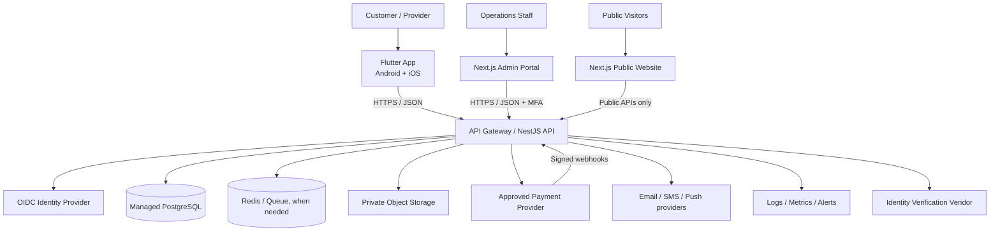
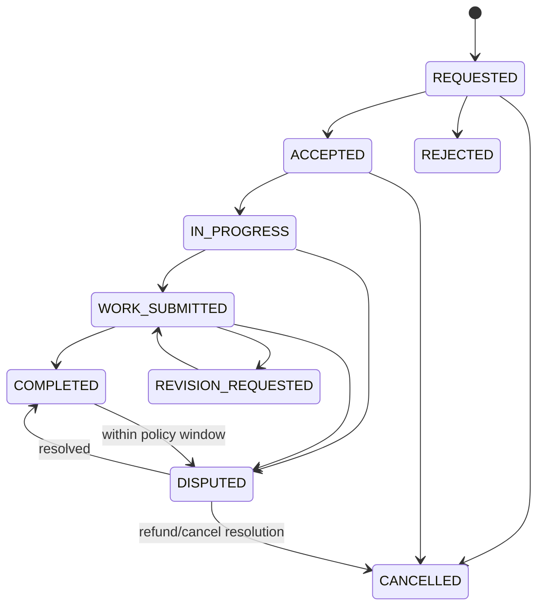
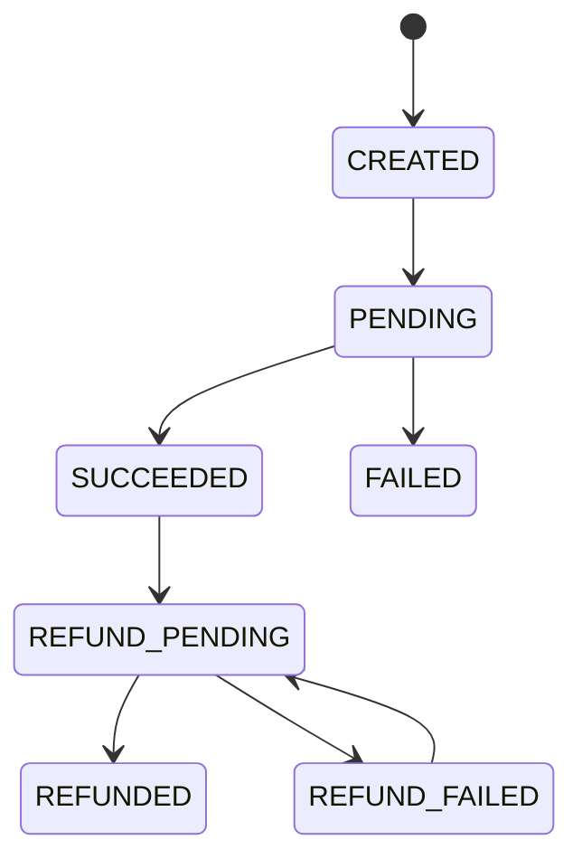
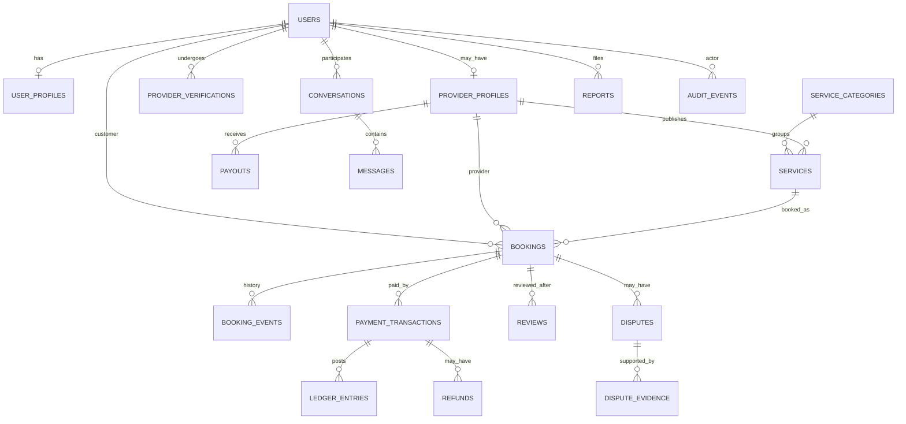

# Side-Hustle Service Marketplace — Product, Frontend, Backend & Security Blueprint

**Document status:** Proposed architecture for planning and MVP implementation  
**Target market:** Philippines first  
**Platforms:** Android, iOS, admin web, public website  
**Product model:** Marketplace connecting customers with independent service providers  
**Important:** This is a technical/product blueprint, not a legal opinion or a guarantee of compliance. A Philippine lawyer, accountant, privacy professional, and prospective payment provider must review the final operating model before real transactions are enabled.

---

## 1. Product vision

Build a trusted marketplace where customers discover and book services from independent providers. Start with lower-risk digital services, prove the booking and trust model, then expand to more categories only after operational, legal, safety, and insurance reviews.

### Proposed launch categories

- Graphic design and illustration
- Video editing
- Writing and translation
- Website development
- Social-media and digital-marketing support
- Photography (initially where booking logistics can be handled safely)

### Exclude from the initial MVP until reviewed

Medical, legal, investment/financial advice, construction, electrical work, security, transportation, childcare, household employment, and other regulated or high-risk in-person services. This is a risk-management choice, not a statement that every such service is unlawful.

### Initial customer promise

- Discover services and compare provider profiles.
- Request a booking and communicate within the app.
- See clear pricing, cancellation terms, and booking status.
- Report a problem and track a complaint.
- Leave a review only after an eligible completed transaction.

### Initial provider promise

- Create a profile and list services after required verification.
- Decide whether to accept a request.
- Set/quote pricing within platform rules.
- Communicate with customers, submit work, and see booking/payment statuses.
- Receive payouts only through an approved payment-provider flow.

---

## 2. Assumptions and decisions to validate

These assumptions are used throughout this blueprint. Do not silently change them during implementation.

1. **One mobile app** for Android and iOS, with Customer and Provider modes. A single account may use both roles, subject to eligibility and verification.
2. **18+ for the MVP** for both customers and providers. Revisit only after counsel reviews minor-consent, labor, privacy, and safety implications.
3. **Independent service marketplace**, not a staffing, payroll, or shift-management product. Providers choose whether to accept work and generally control how they deliver it. Actual operational practices must match the contract; labels alone do not decide legal status.
4. **Digital/low-risk services first.** Service categories, licenses, and geographic availability are configurable by admins.
5. **No proprietary wallet and no self-described escrow in V1.** Use a payment provider that explicitly supports the intended marketplace collection, settlement, refunds, and provider payout flow. Do not promise split payments or payout automation until the provider confirms support and counsel reviews the flow.
6. **Managed identity provider preferred.** Do not create a custom password, MFA, recovery, or identity-verification system unless there is a reviewed business need.
7. **No direct mobile-to-database access.** Every business operation goes through the backend API.
8. **No raw card details stored by the platform.** Use hosted/tokenized payment-provider components.
9. **Government ID minimization.** Prefer a qualified verification vendor that returns a verification result/reference. Store raw ID images only if legally/operationally necessary, with restricted access and an approved retention schedule.
10. **Legal gates before production money movement.** Validate company/tax/LGU registrations, Internet Transactions Act obligations, DPA/NPC obligations, DOLE recruitment/placement exposure, and payment/BSP issues.

### Decisions that must be made before implementation reaches production

- Company/legal entity and contracting parties.
- Exact initial categories and geographic scope.
- Whether the product is request/quote, fixed-price booking, or both.
- Payment provider and supported marketplace settlement/payout mechanics.
- Tax documentation and withholding responsibilities.
- Identity-verification vendor and what evidence must be retained.
- Complaint escalation, refund, cancellation, and dispute policy.
- Cloud region, data residency expectations, recovery-point/recovery-time objectives, and monthly budget.
- Final retention periods with a Philippine privacy/legal adviser.

---

## 3. Recommended technology stack

| Area | Recommendation | Why / guardrail |
|---|---|---|
| Customer/provider mobile app | **Flutter + Dart** | One maintained codebase for Android and iOS; native platform hooks remain available. Use feature-first modules and testable view/data layers. |
| Mobile navigation | GoRouter or equivalent | Central route policy; deep links must still be checked by the backend. |
| Mobile state | Riverpod or Bloc; choose one | Consistent, testable state management. Do not mix multiple global state frameworks without a clear reason. |
| Mobile API client | Typed REST client generated from OpenAPI where practical | Reduces client/server contract drift. |
| Admin portal | **Next.js + TypeScript** | Separate web console, role-based navigation, auditable administrative workflows. |
| Public website | Next.js | Landing pages, help center, policies, contact, account-deletion request page. |
| Backend API | **NestJS + TypeScript** | Modular monolith to start; clear modules, validation, guards, OpenAPI documentation. |
| API style | REST, versioned as `/api/v1` | Straightforward mobile integration and explicit request/response contracts. |
| Primary database | **Managed PostgreSQL** | Transactions, relational constraints, migrations, robust reporting. |
| Queue/cache/rate-limit support | Redis or managed equivalent, when needed | Use for transient cache and jobs; PostgreSQL remains the source of truth for financial records. |
| File/object storage | Private S3-compatible/object storage | Private by default; signed uploads/downloads; malware scanning and retention controls. |
| Authentication | Established OIDC-compatible identity provider or reviewed NestJS auth implementation | Prefer managed security and recovery flows; authorization remains server-side. |
| Payments | A provider that explicitly supports the approved marketplace flow | Do provider/legal diligence before selecting; no raw card data or unapproved holding of funds. |
| Push notifications | FCM for Android and APNs for iOS via a reviewed integration | Notification content must not leak sensitive information. |
| Email/SMS | Reputable transactional messaging vendor | Keep provider credentials on server; rate-limit OTP and notification endpoints. |
| Infrastructure | Managed cloud services, IaC, separate environments | Reduce operational burden; exact vendor and region are a budget/security decision. |
| Observability | Centralized structured logs, metrics, tracing, error monitoring | Redact tokens, IDs, payment secrets, and sensitive personal data. |
| Security baselines | OWASP ASVS for backend/web; OWASP MASVS/MASTG for mobile | Turn security requirements into testable release criteria. |

**Architecture pattern:** Start as a **modular monolith**, not a microservice fleet. Keep domain boundaries clear so a module can be separated later if scale or independent deployment genuinely requires it.

---

## 4. High-level system architecture



**Trust boundary rule:** the mobile app and browser are untrusted clients. They must never have database credentials, payment secret keys, privileged cloud credentials, or authority to decide roles, prices, refunds, booking ownership, or payout amounts.

---

## 5. Frontend plan

### 5.1 Flutter app structure

Use a feature-first structure with clear UI, state/view-model, domain, and data/repository boundaries. Keep screen widgets thin; business rules should be testable without rendering UI.

```text
apps/mobile/
  lib/
    app/
      app.dart
      router.dart
      theme/
      configuration/
    core/
      api/
      auth/
      errors/
      logging/
      secure_storage/
      validation/
      widgets/
    features/
      onboarding/
      authentication/
      account/
      customer_home/
      search/
      categories/
      provider_public_profile/
      service_detail/
      provider_onboarding/
      provider_dashboard/
      service_management/
      booking/
      messaging/
      payment_status/
      earnings_payouts/
      reviews/
      disputes_reports/
      notifications/
      settings_privacy/
    l10n/
  test/
  integration_test/
```

Recommended principles:

- Define tokens for color, type, spacing, controls, empty states, loading states, and error states.
- Use responsive layouts and accessibility semantics; test small Android devices and iPhones.
- Handle unreliable mobile networks: retry only safe/idempotent operations and show clear pending states.
- Use platform secure storage for refresh tokens or sensitive local references. Do not store ID scans, payment secrets, or long-lived bearer tokens in ordinary preferences.
- Validate input client-side for usability **and** validate independently on the server for security.
- Do not rely on client-provided prices, user IDs, roles, payment states, or completion states.
- Keep notifications generic when the device is locked (for example, “You have a new booking update”).
- App attestation can be a risk signal, not the only authorization control or the only way a legitimate user can access the service.

### 5.2 Main navigation

**Unauthenticated:** Welcome → Sign up / Sign in → verification → browse (only if anonymous browsing is permitted).  
**Customer mode:** Home → Search/Categories → Service Detail → Provider Profile → Booking Request → Payment → Booking/Chat → Submit/Confirm Completion → Review → Report/Dispute.  
**Provider mode:** Provider Setup → Verification Status → Dashboard → Services → Requests → Booking Detail → Chat → Deliver Work → Earnings/Payout Status → Reviews.  
**Shared:** Notifications, Account, Privacy, Help/Disputes, Security Sessions, Account Deletion.

A user can switch modes only if their server-side account permits the mode. Hiding a screen in the app is not authorization.

### 5.3 MVP screens

| Screen/area | V1 scope | Important behavior |
|---|---|---|
| Welcome and authentication | Sign up, sign in, verification, recovery | Rate limits and anti-enumeration; show generic errors. |
| Browse/search | Categories, filters, service cards | Only approved and active services show. |
| Service detail | Description, deliverables, price/quote type, cancellation terms | Price and scope are server-sourced. |
| Provider profile | Skills, portfolio, service history, verification badge | Never expose raw ID, private address, or private contact details. |
| Provider onboarding | Profile, category, required verification, tax/business fields | Pending/rejected/approved states and appeal/help path. |
| Provider service editor | Create/edit/disable service | Server-side moderation and category restrictions. |
| Booking | Request/accept/reject/cancel and milestones | Server-owned state machine; every transition audited. |
| Messaging | Transaction-linked chat, block/report | Authorization checks on every conversation and attachment. |
| Payment status | Pending/success/failure/refund status | Provider-confirmed status only; never trust client callback alone. |
| Completion and review | Submit deliverable/confirm completion/review | Reviews only for eligible bookings; prevent duplicate reviews. |
| Dispute/report | Reason, explanation, safe evidence upload, status | Internal reference number, notices, auditable decisions. |
| Settings/privacy | Sessions, MFA options where supported, export/deletion request | Retention exceptions explained; deletion has backend workflow. |

### 5.4 Admin portal

Admin portal is a separate web application. Require MFA, short sessions, least privilege, re-authentication for high-risk actions, and auditable reason codes.

```text
apps/admin-web/
  app/
    login/
    dashboard/
    users/
    providers/
    verification-queue/
    services-moderation/
    bookings/
    payments-refunds/
    payouts/
    disputes/
    reports-abuse/
    compliance/
    audit-log/
    settings/
  components/
  lib/api/
  lib/auth/
  tests/
```

Suggested roles (start with least privilege):

- **Support:** view limited user/booking details, create support notes; no raw ID access or payout-account changes.
- **Moderator:** review services/reports, hide content, suspend accounts with reason; no arbitrary payment actions.
- **Finance:** reconcile transactions and initiate approved finance workflows; no identity-document access.
- **Compliance/Privacy:** access relevant verification/compliance evidence for a defined purpose; all access logged.
- **Security:** investigate abuse and security events, preserve evidence, apply emergency restrictions.
- **Super admin:** rare break-glass access, MFA, justification, alerting, and periodic review.

Avoid one all-powerful everyday admin account.

---

## 6. Backend plan

### 6.1 NestJS modular monolith

```text
apps/api/src/
  main.ts
  app.module.ts
  common/
    auth/
    authorization/
    validation/
    errors/
    rate-limits/
    idempotency/
    audit/
    observability/
  modules/
    users/
    provider-profiles/
    provider-verification/
    service-catalog/
    search/
    bookings/
    conversations/
    messages/
    payments/
    ledger/
    refunds/
    payouts/
    reviews/
    disputes/
    moderation/
    notifications/
    files/
    privacy-requests/
    admin/
    webhooks/
  database/
    migrations/
    seeds/
  test/
```

Keep controllers thin. Controllers validate request shape, authorization guards decide access, services enforce domain rules, repositories persist data, and events/outbox jobs trigger side effects. Never let a controller directly trust state supplied by the client.

### 6.2 Core modules and responsibilities

| Module | Responsibility | Must enforce |
|---|---|---|
| Identity / Users | User reference, contact status, account state, role capabilities | Authentication, account status, minimal profile exposure. |
| Provider verification | Verification status, required document/reference, reason and review history | Least-privilege access, retention rules, no public raw documents. |
| Catalog | Categories, service listings, pricing model, deliverables, active state | Approved categories, validation, moderation. |
| Search | Filter approved listings; ranking can start simple | No sensitive-data ranking; avoid discriminatory or opaque risk scoring. |
| Bookings | Requests and state transitions | Ownership, permissible transitions, idempotency, audit events. |
| Messaging | Conversations attached to valid relationships/bookings | Membership checks for every read/write/file. |
| Payments | Payment intents and verified provider status | Webhook signature validation, idempotency, reconciliation. |
| Ledger | Append-only financial entries | No client balance changes; balanced accounting and reversal entries. |
| Refunds | Review eligibility and call PSP | Role/limit/approval controls and idempotent requests. |
| Payouts | Provider payout status via approved PSP flow | Step-up authentication, change cooldowns, reconciliation. |
| Reviews | Eligible reviews and moderation | One review per eligible transaction per party where policy permits. |
| Disputes | Complaint intake, evidence, SLA, decisions, escalation | Private evidence, auditable actions, clear status timeline. |
| Moderation | Service/user/content reports and takedown actions | Fast escalation for prohibited/unsafe listings. |
| Notifications | Email/SMS/push/in-app notification jobs | No secrets or sensitive IDs in notification content. |
| Privacy requests | Access/correction/deletion requests, retention exceptions | Verify requester; workflow and evidence of completion. |
| Audit | Security/admin/financial event records | Append-only or tamper-evident storage; no secrets in logs. |
| Webhooks | Payment and identity-vendor callbacks | Authenticate signatures; deduplicate; process asynchronously. |

### 6.3 API standards

- Base path: `/api/v1`.
- JSON REST API documented using OpenAPI.
- Use server-generated identifiers (UUID/ULID) and UTC timestamps.
- Use consistent error shape without exposing stack traces or internal details.
- Validate every DTO; reject unknown/unexpected fields where practical.
- Use pagination and server-side filtering for lists.
- Use idempotency keys for booking creation, payment/refund/payout initiation, and webhook processing.
- Do not accept an arbitrary `userId` as proof that the caller owns a resource.
- Treat deep links and mobile routes as navigation only; the API makes the final decision.

Example endpoint set (final contracts should be defined in OpenAPI before implementation):

```text
GET    /api/v1/me
PATCH  /api/v1/me
GET    /api/v1/categories
GET    /api/v1/services
GET    /api/v1/services/:serviceId
POST   /api/v1/provider/application
POST   /api/v1/provider/services
PATCH  /api/v1/provider/services/:serviceId
POST   /api/v1/bookings
GET    /api/v1/bookings/:bookingId
POST   /api/v1/bookings/:bookingId/accept
POST   /api/v1/bookings/:bookingId/reject
POST   /api/v1/bookings/:bookingId/cancel
POST   /api/v1/bookings/:bookingId/submit-work
POST   /api/v1/bookings/:bookingId/confirm-completion
GET    /api/v1/conversations
POST   /api/v1/conversations/:conversationId/messages
POST   /api/v1/payment-intents
POST   /api/v1/disputes
POST   /api/v1/reports
POST   /api/v1/me/deletion-requests
POST   /api/v1/webhooks/payments/:provider
```

Admin operations live under a separate namespace or separate app/API audience, with distinct claims, stricter policies, and mandatory MFA.

---

## 7. Booking, payment, refund, and payout state machines

Keep booking status separate from payment status and payout status. This prevents a payment webhook from accidentally completing a booking or a UI action from marking a payment successful.

### Booking state



Every transition must specify the allowed actor, preconditions, timestamp, and audit event. Customer/provider disagreement must not be silently auto-resolved by the mobile app.

### Payment state



Payment status changes only from authenticated provider responses/webhooks or a verified reconciliation process. A redirect or “success” screen inside the app is not proof of payment.

### Payout state

`NOT_ELIGIBLE → ELIGIBLE → PROCESSING → PAID` with terminal/exception branches `FAILED`, `ON_HOLD`, `CANCELLED` according to the PSP's actual supported workflow. Never show “escrow” or “held safely by the platform” unless the legal/payment design explicitly supports that claim.

---

## 8. Initial database model

Use PostgreSQL with migrations, foreign keys, unique constraints, and transaction isolation appropriate to the operation. Table names are conceptual and must be finalized in the schema review.

### Core tables

| Table | Purpose / notable fields |
|---|---|
| `users` | `id`, `identity_subject`, `email_status`, `phone_status`, `account_status`, `created_at`, `updated_at`. Do not store a second password if using managed identity. |
| `user_profiles` | Public/display name, avatar reference, language and user-editable profile information. Separate public and private fields. |
| `provider_profiles` | `user_id`, headline, skills, bio, approval state, service region/online status, tax/business status flags. |
| `provider_verifications` | Provider, verification vendor/reference, status, reviewed-by, reason code, timestamps; raw document storage only if justified and isolated. |
| `service_categories` | Allowed category, risk level, license/verification requirements, active status. |
| `services` | Provider, category, title, description, pricing model, amount/currency, turnaround, status, moderation fields. |
| `service_media` | Private object references, media type, processing status, moderation/scan state. |
| `bookings` | Customer, provider, service snapshot, agreed scope/price/currency, status, accepted/started/submitted/completed timestamps. Store snapshot fields so later listing edits do not rewrite old contracts. |
| `booking_events` | Append-only state transition history, actor, reason, time, metadata with no secrets. |
| `conversations` / `conversation_members` | Conversation tied to relevant transaction/users. |
| `messages` | Sender, conversation, body, attachments, timestamps, moderation/report state. |
| `payment_transactions` | Booking, PSP reference, amount, currency, state, created/settled times; no raw card data. |
| `ledger_entries` | Append-only debit/credit entries, transaction reference, amount, currency, account key, entry type, reversal link. No update/delete of posted entries; use reversals. |
| `refunds` | Payment, amount, reason, requester/approver, PSP reference, state, audit trail. |
| `payout_profiles` | Provider and PSP token/reference only; no raw bank credentials unless unavoidable and approved. |
| `payouts` | Provider, eligible ledger amount, amount, PSP reference, state, status timestamps. |
| `reviews` | Booking, author, recipient, rating, text, moderation status; unique constraints to prevent duplicate reviews. |
| `disputes` | Booking, complainant, reason, state, assigned role, deadlines, decision, resolution. |
| `dispute_evidence` | Private object reference, submitter, scan status, retention/deletion state. |
| `reports` | Reporter, target type/id, reason, status, triage history. |
| `notifications` | Recipient, template/key, delivery status, created/sent timestamps. Avoid copying sensitive content into logs. |
| `webhook_events` | Provider, unique provider event ID, signature verification result, processing status, received time. Deduplicate by provider+event ID. |
| `idempotency_keys` | Actor, route/operation, key hash, response/result reference, expiry. |
| `audit_events` | Actor, action, target, reason, request/correlation ID, timestamp, limited network/device metadata. Redact sensitive values. |
| `privacy_requests` | Requester, type, verification state, workflow, result, retention exception. |
| `consents` | Notice/version, purpose, user, timestamp, withdrawal state where applicable. |

### Data model diagram



### Financial integrity rules

- The client never computes or writes the authoritative amount owed.
- Persist the agreed amount, currency, platform fee policy version, and applicable tax/withholding calculation metadata as a transaction snapshot.
- Use integer minor units for money (for PHP, centavos), not floating-point values.
- Ledger postings are append-only; corrections are reversals, not edits.
- Reconcile platform records to the PSP's settlement reports regularly.
- Payment webhook processing must be idempotent and concurrency-safe.
- Refund and payout operations require state validation and authorization; no arbitrary amount from the client.
- Tax treatment and withholding must be reviewed by a Philippine accountant before production.

---

## 9. Security and privacy baseline

Security is layered. No single tool, encryption feature, disclaimer, or penetration test guarantees that the product cannot be compromised.

### Identity and sessions

- Prefer an established identity provider or a reviewed authentication implementation.
- Use short-lived access tokens and protected refresh-token/session rotation.
- MFA mandatory for all admin accounts; require step-up authentication for payout-account changes, refunds above configured limits, role changes, and sensitive data access.
- Support viewing and revoking sessions/devices.
- Rate-limit login, recovery, OTP, invitation, and verification flows; consider both account and network signals.
- Use generic auth error messages to reduce account enumeration.

### Authorization

- Deny by default.
- Enforce authorization on the backend for every endpoint and every resource.
- Check both role/permission and ownership/relationship (for example, conversation membership or booking party).
- Separate customer, provider, finance, support, moderation, compliance, security, and super-admin capabilities.
- Use policy/permission tests for all sensitive endpoints.

### Data protection

- TLS for all external and internal service links where applicable.
- Managed encryption at rest with KMS-backed key management for database, object storage, backups, and secrets.
- Keep keys/secrets out of code, mobile packages, source-control history, logs, and build artifacts.
- Separate public profile data from private identity, tax, payout, dispute, and verification data.
- Use private object storage and short-lived signed URLs with ownership/purpose checks.
- For uploads: MIME/type and extension allowlists, size limits, content checks, malware scanning, image re-encoding, quarantine, and access logging.
- Collect only fields needed for stated purposes; create and follow a retention schedule.
- Avoid storing precise location unless the service needs it; do not disclose home addresses by default.
- Redact tokens, government identifiers, bank details, message bodies, and sensitive payloads from telemetry.

### Mobile controls

- Use platform secure storage for sensitive token material.
- Keep secrets out of the application binary; assume an attacker can inspect or modify the app.
- Validate deep links, universal links, exported activities, URL schemes, clipboard use, and file handling.
- Review all third-party SDKs and permissions. Collect the minimum device data needed.
- Consider Play Integrity and Apple App Attest/DeviceCheck as risk signals, with fallback/risk handling for legitimate users.
- Test using OWASP MASVS/MASTG. Do not claim device attestation or certificate pinning makes the app invulnerable.

### Backend and infrastructure

- Global request validation, secure headers, narrowly scoped CORS, rate limiting, request size limits, timeout limits, and safe error responses.
- Strict authorization guards; no endpoint should become public because an annotation was forgotten.
- SQL parameterization/ORM safety; migrations reviewed and tested.
- Production data access only through managed identities/least-privilege roles.
- WAF/API gateway controls where appropriate; separate dev/staging/production accounts/projects.
- CI pipeline: secret scanning, static analysis, dependency/software composition scans, unit tests, API tests, container/IaC scans, signed builds and protected deployment approvals.
- Security alerts for repeated failures, privilege changes, unusual payout updates, new administrator accounts, webhook failures, suspicious data access, and unusual refund patterns.
- Encrypted backups and regularly tested restore procedures.
- Written incident response, account takeover, fraud, payment reconciliation, and breach notification runbooks.

### Security acceptance criteria for launch

- OWASP ASVS baseline chosen and mapped to API/admin acceptance tests.
- OWASP MASVS/MASTG controls selected and tested for mobile.
- Independent penetration test and remediation of critical/high findings.
- No known critical/high dependency vulnerabilities without documented, time-limited exception.
- Access-control tests cover IDOR/BOLA, cross-user booking access, chat access, and private file links.
- Webhook signature, replay, duplicate-event, out-of-order-event, and idempotency tests pass.
- Financial ledger reconciliation test and refund/payout authorization tests pass.
- Backup restore and incident-response tabletop exercise completed.
- DPO/privacy lead and counsel approve privacy/data retention and deletion design.

---

## 10. Marketplace integrity, safety, and compliance workstreams

These items should be treated as product requirements rather than an afterthought.

### Provider verification

- Collect required identity/business/contact/geographic and regulated-profession details as legally applicable.
- Verify consistently and retain evidence of reasonable checks.
- Publish only information required for transparency; never publish government ID or private contact details by default.
- Review verification vendor terms, security, data locations, subprocessors, and deletion functions.

### Prohibited services and moderation

- Maintain a versioned prohibited/restricted-services policy.
- Each category has `allowed`, `restricted`, or `blocked` status plus required verification and review rules.
- Report/takedown process with urgency levels, case ownership, decision rationale, appeal channel, and audit history.
- Create a rapid-response process for illegal, unsafe, infringing, or imminently harmful listings.

### Disputes and customer support

- Accessible in-app complaint/report entry point.
- Case number, timestamps, evidence access controls, state transitions, assigned staff, and clear updates.
- Define cancellation, no-show, incomplete work, quality disputes, refunds, appeal, and escalation policies before payment launch.
- Design for applicable Philippine Internet Transactions Act internal-redress expectations, including the statutory seven-calendar-day exhaustion rule; counsel should validate the exact workflow and current implementing requirements.

### Philippine legal and administrative workstream

Have qualified local advisers confirm applicability and required actions for:

- SEC entity registration (OPC/domestic corporation or other appropriate form), BIR registration and invoicing, LGU permits, and accounting records.
- RA 11967 / Internet Transactions Act, its implementing rules, platform/provider information obligations, complaint/redress, and takedown handling.
- RA 10173 / Data Privacy Act, NPC rules, lawful basis, privacy notices, DPO/privacy responsibility, Privacy Impact Assessment, processor agreements, data-subject rights, and breach response.
- DOLE rules: whether actual matching/referral flows trigger recruitment/placement/private employment agency obligations; review product operations, not merely the provider agreement.
- BIR treatment for platform fees, provider remittances, withholding, receipts/invoices, and provider onboarding.
- BSP/payment-system issues and the chosen payment provider's legal scope for marketplace collections, settlements, refunds, and payouts.
- Trustmark/DTI or other online business registration and disclosure requirements applicable at launch.
- Professional licensing by category, consumer law, intellectual property, insurance, and liability allocation.

Do not hard-code legal conclusions into the app until counsel confirms them. Use configurable policy/category settings where rules may vary.

---

## 11. Repository and project layout

A monorepo helps keep API contracts, security policy, and shared docs consistent. Keep dependency and build tooling separate per app.

```text
sidehustle-marketplace/
  README.md
  AI_HANDOFF_PROMPT.md
  docs/
    product-requirements.md
    architecture.md
    api-contract.md
    data-model.md
    security-threat-model.md
    privacy-and-compliance-checklist.md
    deployment-runbook.md
    diagrams/
      system-architecture.mmd
      booking-payment-flow.mmd
      data-model.mmd
      deployment-security.mmd
  apps/
    mobile/              # Flutter: Android + iOS
    admin-web/           # Next.js admin portal
    public-web/          # Next.js marketing/help/policy website
    api/                 # NestJS modular monolith
  packages/
    api-contract/        # OpenAPI source / generated types
    design-tokens/       # Optional shared design tokens
  infrastructure/
    environments/
    terraform-or-equivalent/
    monitoring/
  .github/
    workflows/
  security/
    policies/
    threat-models/
    incident-response/
```

Do not add infrastructure-as-code or generated package layers just to look sophisticated. Introduce them when ownership, deployment needs, and review practices are clear.

---

## 12. Environments and deployment

Maintain at least three isolated environments:

1. **Local development** — fake/test payment provider, synthetic data, local secrets only.
2. **Staging** — production-like configuration, sandbox payment/identity integrations, no real customer data.
3. **Production** — restricted access, monitored deployments, real secrets from a manager, backup/restore, incident alerts, and approved release gates.

### Release workflow

```mermaid
flowchart LR
    DEV[Feature branch] --> PR[Pull request]
    PR --> CI[Lint + tests + SAST + dependency scan]
    CI --> REVIEW[Code review + security review]
    REVIEW --> STAGE[Staging deploy]
    STAGE --> QA[Integration / acceptance / regression tests]
    QA --> APPROVAL[Release approval]
    APPROVAL --> PROD[Production deploy]
    PROD --> MON[Monitoring + rollback readiness]
```



- Use database migrations that support safe deployment and rollback planning.
- Keep schema changes backward-compatible where possible.
- Feature flags can disable payments, provider onboarding, a category, or other risky functionality quickly.
- Use staged rollouts for mobile releases and have a backend kill switch for high-risk features.
- Prepare App Store and Google Play privacy declarations, account-deletion paths, content moderation, support contacts, and review credentials/test accounts.

---

## 13. Testing plan

### Automated tests

- Unit tests: pricing calculation, role/ownership policies, booking transitions, cancellation/refund policy, ledger posting.
- Integration tests: database constraints, webhook processing, outbox/jobs, identity and PSP sandbox flows.
- API contract tests: OpenAPI schema and generated clients remain in sync.
- Authorization tests: users cannot read/change another user's booking, payout, conversation, verification record, or evidence.
- Idempotency tests: duplicate client retries/webhooks never duplicate payments, ledger postings, refunds, or payouts.
- Mobile widget/unit tests: authentication state, loading/empty/error states, offline/pending states.
- End-to-end tests: customer journey and provider journey on Android and iOS simulators/devices.
- Admin tests: MFA/role policies, approvals, audit records, separation of duties.
- Accessibility/localization and low-bandwidth network tests.

### Human/independent tests before launch

- Threat modeling and abuse-case review.
- Mobile/API/web penetration test.
- Payment reconciliation rehearsal with sandbox and controlled low-value transactions if approved.
- Customer support and dispute tabletop exercise.
- Backup restoration test.
- Privacy request/deletion rehearsal.
- Incident/breach-response tabletop exercise.

---

## 14. Phased implementation roadmap

### Phase 0 — product/legal discovery

**Deliverables:** agreed product scope, service category matrix, contracts/policies outline, legal questions log, payment provider shortlist, privacy data map, risk register.  
**Exit gate:** Philippine counsel/accountant/privacy adviser has reviewed the intended operating and payment model enough to proceed with design.

### Phase 1 — design system and foundation

**Deliverables:** repository, CI, environments, design tokens, navigation skeleton, API OpenAPI skeleton, database migration system, auth integration, logging/monitoring, threat model.  
**Exit gate:** no production secrets in repos/builds; basic authenticated API and mobile flows work in staging.

### Phase 2 — browse and provider onboarding

**Deliverables:** account/profile, service categories, service search/listing, provider application/verification status, admin verification/moderation queue.  
**Exit gate:** only eligible approved providers/services are public; data-access tests pass.

### Phase 3 — booking and messaging

**Deliverables:** request/accept/reject/cancel workflow, booking events, conversation membership, report/block controls, push/email notifications.  
**Exit gate:** booking state machine and user-ownership tests pass; support can investigate incidents.

### Phase 4 — payments in sandbox

**Deliverables:** provider-selected integration, payment intent/status, signed webhooks, idempotency, ledger, refund workflow, reconciliation reports.  
**Exit gate:** provider and legal reviewers approve the real funds flow; duplicate/out-of-order webhooks do not corrupt records. Do not launch money movement before this gate.

### Phase 5 — completion, reviews, disputes

**Deliverables:** work submission/completion, eligible reviews, dispute intake, evidence upload, case queue, case audit trail and service-level tracking.  
**Exit gate:** complaint/redress and dangerous-listing takedown workflows rehearsed.

### Phase 6 — private beta and production readiness

**Deliverables:** penetration test, remediation, privacy and deletion flows, incident response, backup restore, customer support runbook, store listing assets, analytics with PII minimization.  
**Exit gate:** no unresolved critical/high security findings; compliance and payment approvals recorded; operations ownership assigned.

### Phase 7 — controlled launch and iteration

Begin in a limited geography/user cohort/category set, watch fraud/disputes/support load, measure trust and fulfillment quality, then expand after a formal review.

---

## 15. MVP success metrics

Measure marketplace quality, not only downloads:

- Provider application approval time and rejection reasons.
- Search-to-service-detail conversion.
- Booking request acceptance rate and median response time.
- Completion and cancellation/no-show rates.
- Dispute rate and time to resolution.
- Refund/chargeback/fraud rates.
- Repeat customer rate and repeat provider activity.
- Provider payout success and reconciliation breaks.
- Support tickets per 100 bookings.
- Security/privacy incidents and time to contain.
- Percentage of active listings with current required verification.

Avoid collecting more personal data merely to improve analytics. Use aggregates and retention limits.

---

## 16. Definition of done for any feature

A feature is not complete just because the screen works. Before merge, confirm:

- The happy path, empty state, loading state, validation state, failure state, and retry behavior are implemented.
- Server-side authentication, authorization, ownership, and state-transition rules are tested.
- Sensitive inputs are validated and output is safely encoded.
- Logs do not contain secrets or unnecessary personal data.
- User-facing copy/policies reflect the actual system behavior.
- Analytics are privacy-reviewed and minimize data.
- Error/abuse cases have owner-facing operational handling.
- Unit/integration/e2e tests are present where appropriate.
- API contract, schema migration, and documentation are updated.
- Accessibility and Android/iOS differences are checked.

---

## 17. Reference links

Verify official documentation again when implementation begins; library versions and regulatory guidance can change.

### Engineering

- Flutter app architecture: https://docs.flutter.dev/app-architecture/guide
- NestJS authentication: https://docs.nestjs.com/security/authentication
- NestJS authorization: https://docs.nestjs.com/security/authorization
- NestJS rate limiting: https://docs.nestjs.com/security/rate-limiting
- OWASP ASVS: https://owasp.org/www-project-application-security-verification-standard/
- OWASP MASVS: https://mas.owasp.org/MASVS/
- OWASP MASTG: https://mas.owasp.org/MASTG/

### Philippines legal/regulatory starting points (not exhaustive)

- Republic Act No. 11967 / Internet Transactions Act: https://lawphil.net/statutes/repacts/ra2023/ra_11967_2023.html
- National Privacy Commission: https://privacy.gov.ph/
- Bangko Sentral ng Pilipinas — Payments and Settlements: https://www.bsp.gov.ph/SitePages/PaymentsAndSettlements/PaymentsAndSettlements.aspx
- DTI E-Commerce Philippine Trustmark: https://trustmark.dti.gov.ph/
- Bureau of Internal Revenue: https://www.bir.gov.ph/
- Securities and Exchange Commission: https://www.sec.gov.ph/
- Department of Labor and Employment: https://www.dole.gov.ph/

---

## 18. Final recommendation

Build the **smallest safe marketplace first**: one Flutter app, one admin portal, one public website, a modular NestJS API, PostgreSQL, private file storage, and one legally reviewed payment-provider flow. Start with low-risk service categories, keep the provider/customer relationship clear, build verification/reporting/disputes and auditability early, and expand only after observed risk and legal review.

**Security goal:** measurable defense in depth, tested controls, limited data, and a rehearsed incident response—not an unprovable promise of zero risk.
