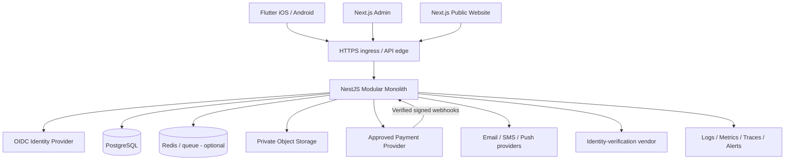

# Production Specification V3

**Status:** Target requirements. This is not evidence of implementation, audit, or approval.  
**Product model:** A marketplace facilitating discovery, communication, booking and service transactions between customers and independent providers. Actual behavior and contractual structure must be reviewed by qualified Philippine counsel.

## 1. Objectives and non-goals

### Objectives

- Ship one Flutter mobile application for Android and iOS.
- Provide a Next.js public website and a role-restricted operations/admin portal.
- Build a secure, testable NestJS modular monolith with a versioned REST API and OpenAPI contract.
- Preserve financial correctness, privacy, auditability, complaint handling and recoverability.
- Test repeatably on developer machines using Docker Compose, and test Kubernetes deployment behavior in a disposable `kind` cluster.
- Make every launch-critical requirement testable and assigned to an owner.

### Non-goals for MVP

- No payroll, shift assignment, or employee workforce-management workflows.
- No proprietary stored-value wallet.
- No in-house escrow promise, custody model or arbitrary holding of money without an approved provider/legal structure.
- No microservice fleet, service mesh, event streaming platform, or production Kubernetes commitment without a justified operational need.
- No high-risk or regulated service categories until separate category-specific review is complete.
- No automated irreversible fraud decisions without suitable review, appeal, privacy assessment and legal review.

## 2. Recommended architecture and environment strategy

### Logical architecture



### Environment strategy

| Environment | Purpose | Data | Money movement | Infrastructure |
|---|---|---|---|---|
| Developer | Fast feature work | Synthetic | Disabled/mock only | Local tools, optional Compose |
| Automated test | Repeatable unit/integration/contract tests | Generated fixtures | Mock/sandbox only | CI runner + Compose services |
| Kubernetes test | Test container config, probes, service discovery, resource/security settings | Ephemeral synthetic | Disabled/mock only | Disposable `kind` cluster |
| Staging | Production-like acceptance and operational rehearsals | Synthetic or properly de-identified | PSP sandbox only | Isolated cloud environment |
| Production | Real users and approved business activity | Real, protected | Only after signed approvals | Managed production services, IaC, controlled releases |

Use a separate identity tenant/project, database, object-storage bucket, PSP credentials, keys, domain and access roles for each environment. Never point local or test containers at production data or services.

## 3. Technology choices and guardrails

- **Mobile:** Flutter/Dart, feature-first architecture, one agreed state-management framework, typed API client generated from OpenAPI where practical, OS-backed secure storage for tokens/secrets, platform permission minimization.
- **Admin/public web:** Next.js + TypeScript. Admin deployed separately from public pages or protected with independent access controls and routing policy.
- **API:** NestJS + TypeScript, modular monolith, DTO/schema validation at every boundary, global error handling, versioned `/api/v1` routes, generated OpenAPI.
- **Database:** PostgreSQL; migration tool selected and locked before first feature migration. Use constraints and transactions to preserve invariants.
- **Redis:** optional; only for cache, rate limiting, queues/locks where correctly designed. Never use it as the authoritative transaction ledger.
- **Async work:** begin with a durable database-backed/outbox approach or an appropriately operated queue. Define retry, dead-letter/manual-recovery and idempotency behavior.
- **Files:** private object storage; short-lived scoped URLs; antivirus/content scanning; lifecycle/retention rules.
- **Identity:** prefer a maintained OIDC identity provider. App identity proves authentication, not authorization; API still checks role, ownership, status and context.
- **Payments:** choose only after written confirmation the PSP supports the exact marketplace model in the Philippines. Keep cards and provider secrets outside platform storage.
- **Infrastructure:** Terraform/OpenTofu or another reviewed IaC system after cloud and environment choices are made. No hand-edited production resources without recording the change and reconciling it to IaC.
- **Containers:** multi-stage minimal images, non-root runtime, read-only root filesystem where supported, pinned reviewed image versions/digests, vulnerability scanning, SBOM, signed/promoted immutable image artifacts where tooling supports it.
- **Kubernetes:** use `kind` for local functional deployment testing. Production Kubernetes is a later decision; prefer managed services/platforms when they meet requirements at lower operational burden.

## 4. Repository structure target

```text
apps/
  mobile/                # Flutter
  admin-web/             # Next.js privileged operations portal
  public-web/            # Next.js public pages/help/policies
  api/                   # NestJS API
packages/
  api-client/            # Generated typed client; do not hand-edit generated output
  contracts/             # Shared schemas only where useful
  config/                # Shared lint/format/type conventions
infra/
  iac/                   # Reviewed cloud resources; chosen provider TBD
  environments/           # Non-secret environment configuration only
 devops/
  docker/                # Local integration services and Dockerfiles
  kubernetes/test/       # Local test-only manifests
  ci/                    # Pipeline templates/policies
  runbooks/              # Or link to docs runbooks
 docs/
  openapi/               # Source API contract
  decision-records/      # ADRs
  threat-model/          # Threats and mitigations
  runbooks/              # Operations
```

The exact monorepo tool (npm workspaces, pnpm, or another) must be selected before generating lockfiles. Do not mix package managers.

## 5. Domain modules and ownership

Each module owns its domain rules and tables. Other modules call typed application services or public interfaces rather than issuing arbitrary cross-module writes.

1. **Identity & access:** user identity mapping, account state, sessions/roles sourced from trusted identity claims, step-up-auth decisions. Do not put ID documents in ordinary user rows.
2. **Customer/provider profiles:** public and private field separation, verification state, provider service eligibility.
3. **Catalog & search:** service categories, listings, pricing/quote mode, moderation state, availability indexes.
4. **Booking:** request/accept/reject/cancel/complete state machine, ownership, deadlines and policy snapshots.
5. **Messaging:** conversation access bound to booking/participants, report/block, rate limits, retention rules.
6. **Payments:** provider checkout references, signed webhook processing, transaction idempotency, refunds, reconciliation.
7. **Ledger & payouts:** immutable journal entries, balanced postings, settlement state, payout requests/results; no client-calculated balances.
8. **Reviews:** only transaction-eligible reviews, fraud prevention, moderation and appeals.
9. **Trust/safety:** complaints, prohibited listings, account restrictions, evidence access logs, action review.
10. **Compliance:** provider tax/document status and policy versions; access strictly limited. This module supports but does not replace professional advice.
11. **Notifications:** transactional delivery only, redacted content, preference/consent handling, retries and suppression.
12. **Admin/audit:** least-privilege operations, reason codes, immutable/security-protected event history.

## 6. API, schema and transaction design

### API conventions

- All app endpoints are under `/api/v1`; public health endpoints are intentionally minimal.
- OpenAPI is the source contract. CI validates the specification and checks for unintended breaking changes.
- Use stable error objects with machine-readable codes and request/correlation IDs. Do not return stack traces, SQL, secrets or internal provider payloads.
- Validate body, query, path and headers. Apply allowlists for writable fields to prevent mass assignment.
- Enforce maximum page size, bounded sorting/filtering, upload limits, request timeouts and rate limits.
- For state-changing endpoints, support an idempotency key where retries could duplicate bookings, payments, refunds or payouts.
- Use optimistic concurrency/version fields for operations where simultaneous changes would otherwise violate state.
- Do not expose internal database IDs as authorization. Random IDs do not replace ownership checks.
- Webhook endpoints are separate, verify signatures and timestamps according to the PSP specification, persist event identity before work, reject replay/duplicate effects, and acknowledge only after durable recording.

### Initial route families

- `/health/live`, `/health/ready` — operational health, no secrets/verbose dependency details.
- `/api/v1/me`, `/api/v1/me/sessions`, `/api/v1/me/data-export`, `/api/v1/me/account-deletion`.
- `/api/v1/services`, `/api/v1/services/{serviceId}`, `/api/v1/providers/{providerId}/public-profile`.
- `/api/v1/provider/onboarding`, `/api/v1/provider/services`, `/api/v1/provider/verification-status`.
- `/api/v1/bookings`, `/api/v1/bookings/{bookingId}`, explicit action routes for accept/reject/cancel/submit-work/complete.
- `/api/v1/bookings/{bookingId}/messages`, `/api/v1/reports`, `/api/v1/blocks`.
- `/api/v1/payment-intents` or provider checkout session endpoint only after payment design is chosen; use provider-neutral internal abstractions without pretending all PSPs have identical semantics.
- `/api/v1/refunds/{refundId}` and `/api/v1/payouts/{payoutId}` restricted to authorized service workflows/admins.
- `/api/v1/reviews`, `/api/v1/disputes`, `/api/v1/admin/...` with separate role permissions and audit policy.

The starter YAML is intentionally partial. Expand request/response schemas, authentication scheme, error variants and every route before implementation. Generated clients and contract tests must match the approved contract.

### Database domains

At minimum plan tables/entities for:

- `users` / `external_identities` / `account_status_history`;
- `roles` and server-enforced permissions (or trusted identity claims mapped to local policy);
- `provider_profiles`, `provider_verifications`, `provider_documents_metadata`, `provider_tax_status`;
- `service_categories`, `service_listings`, `listing_moderation_events`;
- `bookings`, `booking_events`, `booking_policy_snapshots`;
- `conversations`, `conversation_members`, `messages`, `reports`, `blocks`;
- `payment_attempts`, `provider_webhook_events`, `refunds`, `settlements`, `payouts`;
- `ledger_accounts`, `ledger_transactions`, `ledger_entries`;
- `reviews`, `disputes`, `dispute_evidence_metadata`, `admin_actions`, `audit_events`;
- `notification_outbox`, `outbox_events`, `idempotency_records`;
- `privacy_requests`, `retention/deletion job records`, where required.

Use foreign keys, unique constraints, check constraints, appropriate transaction isolation, indexes and explicit deletion rules. Use UTC timestamps and store money with currency. Define indexes from query plans, not guesses. Never store bank credentials or raw card details.

### Financial invariants

- Represent PHP as integer centavos or a deliberate fixed-precision numeric type; never IEEE floating point.
- Separate customer charge, PSP fee, platform fee, tax/withholding, refunds, provider gross, net payout and adjustments as individually auditable values.
- Ledger entries are append-only; corrections are compensating entries with reasons, never silent updates/deletes.
- Every journal transaction balances debits and credits; enforce this via a reviewed transaction-writing service and validation/invariant tests.
- A provider webhook can have at most one effect per provider event/transaction identity; enforce uniqueness at the database level.
- Reconcile payment intents, provider reports, chargebacks/refunds, settlements, ledger, and payout records daily at minimum once real money is enabled.
- Never infer success from the mobile redirect/return page; authoritative outcome comes from the PSP API/webhook plus reconciliation policy.
- Do not claim escrow or split settlement until provider capability and applicable legal structure are confirmed.

## 7. State machines

Write and test transition tables before implementing these domains.

### Booking baseline (validate product policy)

`REQUESTED -> ACCEPTED | REJECTED | CANCELLED`  
`ACCEPTED -> IN_PROGRESS | CANCELLED | DISPUTED`  
`IN_PROGRESS -> SUBMITTED | CANCELLED only under approved policy | DISPUTED`  
`SUBMITTED -> COMPLETED | REVISION_REQUESTED | DISPUTED`  
`REVISION_REQUESTED -> SUBMITTED | DISPUTED`  
`COMPLETED -> REVIEW_WINDOW_CLOSED` (review eligibility depends on policy)  

Transitions must be actor-authorized, time/policy-aware, and recorded with an event, timestamp, actor and reason. Reject impossible transitions on the server.

### Payment baseline

`CREATED -> PENDING_PROVIDER -> SUCCEEDED | FAILED | EXPIRED` with separate states for refund/chargeback/settlement. Do not overload the booking status with payment status. Record the provider's raw event securely only as justified; persist normalized event identity/status and scrub secrets/PII.

### Payout baseline

`NOT_ELIGIBLE -> ELIGIBLE -> REQUESTED -> UNDER_REVIEW (if required) -> SUBMITTED_TO_PSP -> PAID | FAILED | REVERSED`.

A timeout is not proof of failure. Query/reconcile with the PSP before retrying an ambiguous operation. Do not blindly repeat payout calls.

## 8. Authentication and authorization

- Prefer managed OIDC with authorization-code flow and PKCE for mobile. Validate issuer, audience, signature, time claims and expected scopes/claims on backend. Define safe token refresh/logout/session revocation behavior.
- Admin users use a distinct access path and mandatory strong MFA; consider phishing-resistant factors for privileged roles.
- Require recent reauthentication/step-up authentication for email/phone changes, payout changes, identity changes, sensitive exports, high-risk admin actions and security-setting changes.
- Check role + object ownership + status + contextual policy on every sensitive operation. Do not trust client-supplied user IDs, role names, prices or status values.
- Test BOLA/IDOR and mass assignment for all endpoints with another user's IDs, guessed IDs, unauthorized status transitions and admin-only fields.
- Apply per-IP, per-account, per-device and business-action rate limits where appropriate; OTP/account recovery requires abuse controls and spend limits.
- Admin role separation: support, moderator, compliance, finance, security and super-admin. Avoid one all-powerful shared account. Audit high-risk read access as well as writes.

## 9. Privacy and data protection requirements

- Maintain a data inventory: fields, purpose, proposed lawful basis to be validated, access roles, processors/recipients, retention period and deletion behavior.
- Separate public profile from private contact, verification, tax, payout and dispute evidence. Use field-level/service-level access restrictions for the highest-risk classes.
- Keep IDs/private attachments in dedicated private storage. Avoid raw government ID retention if provider verification result/reference is sufficient; approve the exception and retention period before collection.
- Redact tokens, government IDs, precise addresses, payment details and private message content from logs, analytics, crash telemetry and notifications.
- Provide data-subject request intake for access/correction/deletion as applicable, with documented legal/tax/dispute/security retention exceptions. Deletion must propagate through primary data, object store, indexes, caches, exports and backup expiry according to an approved schedule.
- Complete a Privacy Impact Assessment and data-processing inventory; evaluate DPO, NPC registration, automated profiling, cross-border transfers and processor obligations with a privacy professional.
- Maintain an incident decision tree, internal escalation list, evidence preservation procedures and a clock for legally required notifications.
- Do not infer that consent is the right lawful basis for every data operation; obtain professional review of each purpose.

## 10. Secure file and messaging design

- Upload via short-lived, user/object-scoped signed URL after server authorization; complete upload by a callback/API that validates the uploaded object's ownership and metadata.
- Set size, count, extension and content limits; verify content rather than relying on claimed MIME type. Malware scan and isolate untrusted files before release.
- Generate object keys server-side. Never let users choose arbitrary filesystem paths/object keys.
- Use private buckets, encryption, access logs, lifecycle retention, and no public bucket ACLs for ID or dispute evidence.
- Messaging access is limited to conversation members; for booking-bound chat, enforce relationship to the booking and account status. Provide block/report, rate limits, moderation queues, retention and documented escalation response.
- Never send private message contents, ID data or sensitive dispute details in push/email subject lines by default.

## 11. Container and infrastructure requirements

### Build requirements

- Build from a minimal supported LTS base and a multi-stage Dockerfile; install locked dependencies with a frozen lockfile.
- Run the API as non-root; include only runtime dependencies; use a read-only root filesystem where compatible and explicit writable temporary/cache mounts.
- Pin container images to reviewed versions and preferably digests in CI/production; update on a defined patch cadence.
- Scan dependencies and images; generate SBOM; sign/provenance images if tooling is available. Block release on defined critical/high vulnerabilities unless a documented, time-bound exception is approved.
- Run tests against the built image, not only source code. Set CPU/memory limits and graceful shutdown behavior.
- Never include `.env`, cloud credentials, signing keys, PSP secrets, ID files, Git history, test datasets or private config in Docker build context/image.

### Deployment progression

1. Local process/tests.
2. Docker Compose for repeatable database/cache/dependency integration tests.
3. Containerized API smoke test.
4. `kind` cluster for Kubernetes manifests, probes, service discovery, rollout, resource limits and restricted security context tests.
5. Cloud staging smoke/performance/restore/incident rehearsals.
6. Controlled production rollout only after sign-offs.

### Kubernetes testing requirements

- Local tests use ephemeral test database/cache and synthetic data only.
- Set requests/limits, startup/readiness/liveness probes, non-root security context, dropped capabilities, `allowPrivilegeEscalation: false`, seccomp `RuntimeDefault`, and a read-only root filesystem for the API where supported.
- Do not mount Docker socket or host paths into application pods. Do not grant privileged mode or cluster-admin to application service accounts.
- Disable automatic service-account token mounting unless the app requires Kubernetes API access.
- Do not store production secrets in manifests/ConfigMaps. Local test secrets are disposable and test-only; production secrets need an approved secret manager/injection integration.
- Use namespaces per environment and restrict network paths where the selected CNI enforces NetworkPolicy. Test manifests are not a production security baseline by themselves.
- Test failed rollout, readiness failure, graceful shutdown and rollback. Test horizontal scaling only after the API has no in-memory session/source-of-truth assumptions.
- Database migrations run as a separate reviewed release job, not as a destructive API startup side effect. Migrations must be backward-compatible across the rollout window (expand/migrate/contract pattern).

## 12. CI/CD and supply-chain plan

Every pull request should run:

1. Format/lint, type checking, unit tests.
2. Migration lint/validation and schema consistency checks.
3. OpenAPI syntax validation and compatibility diff.
4. Backend authorization/ownership tests, including negative cases.
5. Integration tests with fresh isolated Compose dependencies.
6. Mobile/web tests relevant to changed paths.
7. Dependency, license-policy, secret and static security scanning.
8. Container build, image vulnerability scan and SBOM generation when the API container changes.
9. Artifact retention and test report upload with sensitive output scrubbed.

Promotion model:

- Build one immutable image per reviewed commit; tag with commit SHA, never rely on mutable `latest` in staging/production.
- Promote the same digest through test/staging/production.
- Environments obtain configuration/secrets at runtime, not from the image.
- Production deploy requires human approval, change summary, rollback method, migration compatibility check, monitoring window and named release owner.
- Pin third-party CI actions to reviewed versions/commit SHAs when configuring real workflows; give CI least-privilege short-lived credentials using the platform's OIDC integration where possible.
- No CI job should automatically activate real-money settings or create production payout credentials.

## 13. Reliability, observability and support

Set initial measurable objectives before public launch; use these as proposed starting points, not guarantees:

- API availability objective: 99.5% monthly for MVP after a stable baseline is measured.
- API p95 latency target: under 500 ms for typical non-search read/write operations, excluding external PSP/IDV calls; refine after load tests.
- Recovery point objective: target 15 minutes or better only if backup/replication design and budget support it; decide explicitly.
- Recovery time objective: target 4 hours or better only after restoration exercises prove it; decide explicitly.
- Zero unresolved critical security findings; no unresolved high finding without written risk acceptance by the named accountable owner and compensating controls.

Observe request rate, errors, latency, saturation, database pool/locks, queue age/dead letters, PSP webhook lag/failures, payment-to-ledger mismatches, payout failures, report/dispute backlog, login/OTP abuse, storage upload failures, backup age and restore-test status.

Logging requirements:
- Structured logs with UTC timestamp, severity, environment, service version, trace/request ID and outcome.
- Never log secrets, raw access tokens, passwords/OTP, raw payment credentials, government IDs or unnecessary message body/PII.
- Access to audit/security logs is restricted and monitored; retain according to policy and applicable obligations.
- Every alert has an owner, severity, response target, escalation contact and runbook.

## 14. Release strategy

1. Internal alpha with seeded synthetic users and mocked/sandbox payments.
2. Closed beta with invited adults and reviewed low-risk categories; support and incident coverage active.
3. Limited production cohort only after business/legal/PSP/security gates pass; money movement stays disabled until the PSP flow and settlement reconciliation pass.
4. Observe metrics, fraud, complaints, support workload, crash rates and settlement reconciliations before expanding.
5. Progressive rollout/feature flags; kill switch for new bookings and payment initiation separate from access to existing records/refunds/support.
6. Rollback must cover application and config. Database changes require forward/backward compatibility or a documented compensating migration.

## 15. Production go/no-go evidence

No launch approval is complete without evidence linked to each applicable criterion:

- [ ] Accountable business owner and operations owner named.
- [ ] Scope/categories and user agreements approved for this operating model.
- [ ] Applicable Philippine legal/tax/privacy and payments review documented by qualified professionals.
- [ ] PSP approves exact collection/refund/settlement/payout model; provider reconciliation demonstrated in sandbox.
- [ ] All API operations documented in OpenAPI and versioning policy established.
- [ ] Migrations are reproducible from a clean database and tested against supported upgrade path.
- [ ] Ownership/authorization tests cover every sensitive route and object family.
- [ ] No unresolved critical/high security findings, or approved documented exception only where policy permits.
- [ ] Independent penetration test completed after code freeze/release candidate; remediation retested.
- [ ] Container/image/dependency checks pass; deployment artifact immutable and traceable.
- [ ] Backups, restore, incident response, access revocation and rollback drills succeeded.
- [ ] Monitoring, alert routing, on-call and customer support processes are live.
- [ ] Account deletion/data requests, moderation/reporting, dispute and complaint workflows are exercised.
- [ ] Apple/Google privacy, safety, age, UGC and account deletion requirements reviewed for actual implementation.
- [ ] All test/prod isolation, secrets, domain/TLS, WAF/rate limits and least-privilege controls verified.
- [ ] Named sign-off by engineering, operations, business owner and relevant local professionals.

## 16. Standards and references

Verify current versions when work starts; use standards as testable references rather than marketing claims:

- OWASP ASVS: https://owasp.org/www-project-application-security-verification-standard/
- OWASP MASVS / MASTG: https://mas.owasp.org/
- NIST SSDF: https://csrc.nist.gov/projects/ssdf
- Docker build best practices: https://docs.docker.com/build/building/best-practices/
- Docker Compose environment guidance: https://docs.docker.com/compose/how-tos/environment-variables/best-practices/
- Kubernetes probes: https://kubernetes.io/docs/tasks/configure-pod-container/configure-liveness-readiness-startup-probes/
- kind quick start: https://kind.sigs.k8s.io/docs/user/quick-start/
- Philippine National Privacy Commission: https://privacy.gov.ph/
- BSP payments and settlements: https://www.bsp.gov.ph/SitePages/PaymentsAndSettlements/PaymentsAndSettlements.aspx
